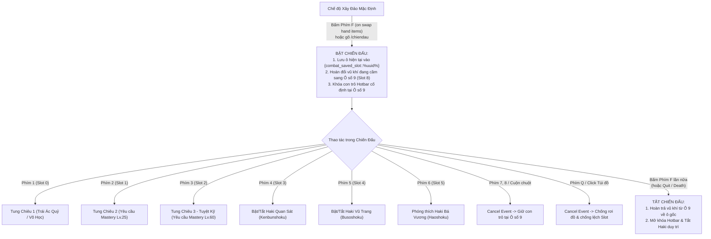
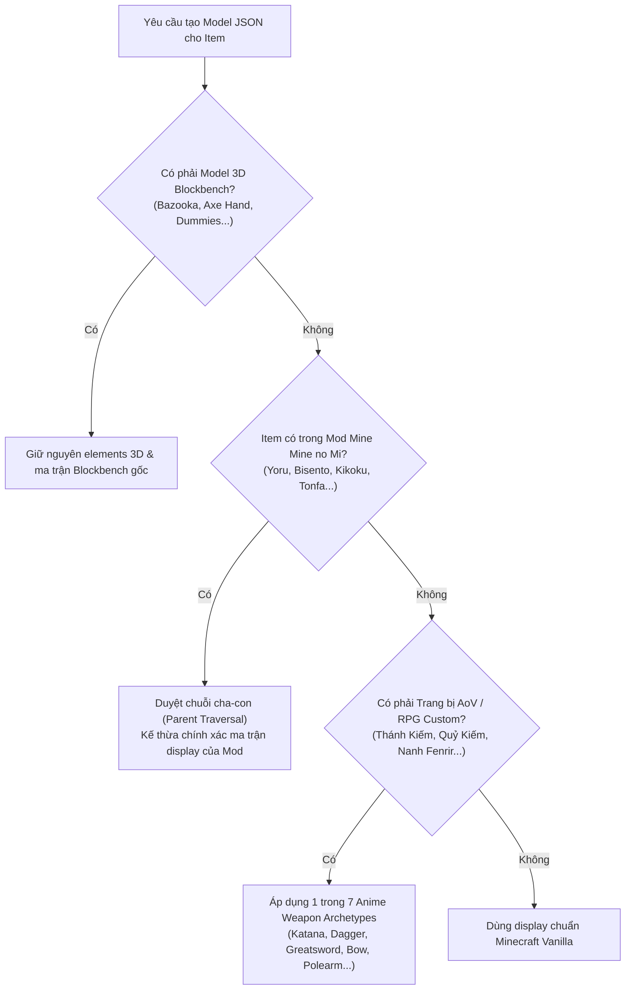
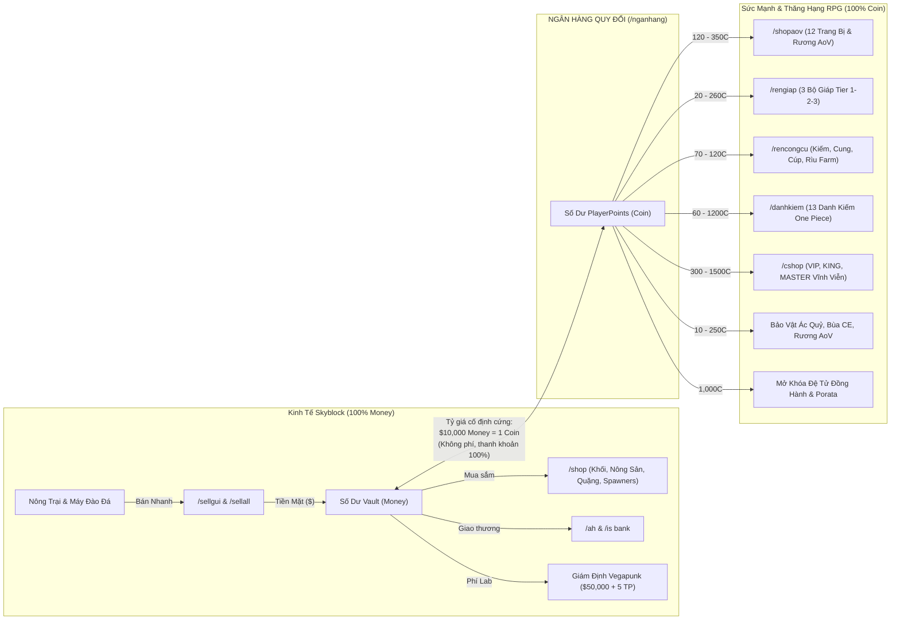
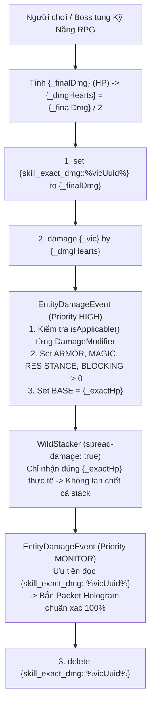

# MINECRAFT 1.12.2 RPG SKYBLOCK — TECHNICAL SPEC & AGENT HANDOVER

> **Mục đích tài liệu:** Cung cấp bản đồ kiến trúc cô đọng, chuẩn xác (Single Source of Truth) cho AI Agent và Senior Developer trong các phiên làm việc tiếp theo.  
> **Trạng thái hệ thống:** Đã hoàn thành toàn bộ Phase 1–16 & **Hotfix Nametag Multi-Scoreboard Sync (Tương thích SkBee 1.10.3)**, **Hotfix Khẩn Cấp Triệt Tiêu Sát Thương 19997/19998 & Đồng Bộ Packet Damage Hologram**, **Bản Vá Cân Bằng 6 Lỗi Hệ Thống Combat Core**, **Hotfix Kinh Tế Siêu Thị WildStacker Spawner/Egg**, **Hotfix Đồ Họa 3D / Hợp Nhất Faithful 64x64 + Mod Mine Mine no Mi**, **Hệ Thống Khóa Bảo Vệ 4 Lớp Chống Tháo Rig 3D (`Is3DRig: 1b`, `DisabledSlots: 2039583`)**, **Texture Atlas Đặc 100% (`alpha = 255`)**, **Hình Học Khối Rắn Chuẩn Hóa `make_cube()`**, **Bộ Ma Trận Cầm Vũ Khí Chuẩn Mod (`display` transforms 149 Item Mod + 52 Anime Weapon Archetypes)**, **Hiệu Chỉnh Tọa Độ Tiếp Đất Cho Vua Biển & Bù Nhìn (`display.head`)**, **Hệ Thống Resource Pack Độc Quyền 2D/3D (Vanilla Durability Predicate `diamond_hoe` 1,028 Model ID)**, Cơ chế điều khiển **MOBA Quick-Cast**, **Hệ thống Chat UI/UX & Thông Báo Chuẩn Hóa**, **Tối ưu sâu WildStacker v2026.3** và **Triệt tiêu lỗi `AssertionError` (`AliasesMap.matchAlias`) / Lỗi Đầu 3D Steve**. Toàn bộ **19/19 module Skript** nạp 100% 0 lỗi cú pháp, vận hành ổn định ở 19–20 TPS.

---

## 1. MÔI TRƯỜNG & HẠ TẦNG CỐT LÕI

| Thành phần | Phiên bản / Đường dẫn | Ghi chú Kỹ thuật Bắt buộc |
| :--- | :--- | :--- |
| **Server Core** | `Paper 1.12.2-R0.1-SNAPSHOT` (`git-Paper-1618` / `1620`) | Tối ưu TPS, giới hạn dòng Scoreboard $\le 32$ ký tự (FastBoard $16+16$), giới hạn dòng Chat $\le 28$ ký tự. |
| **Java Runtime** | `Java 17 LTS` (`run.bat`) | **Không hạ về Java 8** vì `LuckPerms 5.5.91`, `ProtocolLib`, `SuperiorSkyblock2-2026.3` yêu cầu Java 17. |
| **Skript Engine** | `Skript-2.6.4.jar` | Bản cuối hỗ trợ chính thức MC 1.12.2 + Java 17. |
| **Skript Addons** | `SkBee-1.10.3.jar`, `skript-reflect.jar` (**v2.3**) | **Không nâng** `skript-reflect` lên v2.4 (v2.4 yêu cầu Skript 2.7+). |
| **Core Plugins** | `SuperiorSkyblock2-2026.3`, `Ore.jar` (WonderOreGen v1.0), `LuckPerms-5.5.91`, `Vault`, `PlaceholderAPI-2.12.3`, `ProtocolLib`, `item-nbt-api-2.16.1` | Quản lý Căn Cứ Hải Tặc, Máy tạo đá 5 cấp, Phân quyền, Tiền tệ & NBT. |
| **Gameplay Plugins** | `EssentialsX-2.22.0`, `PlayerPoints-3.3.5`, `ChestCommands-4.0.5`, `CrazyEnchantments-1.8.1.1`, `CrazyAuctionsPlus-1.3.3.0`, `EconomyShopGUI-6.16.4`, `WildStacker-2026.3` | Đã Việt hóa 100%, đồng bộ kinh tế/quyền hạn và cấu hình chống xung đột Boss/Item RPG. |

---

## 2. KIẾN TRÚC ĐIỀU KHIỂN CHIẾN ĐẤU MOBA QUICK-CAST (`06`, `07`, `08`)

Hệ thống sử dụng cơ chế **Khóa Ô Neo (Anchor Slot 9 / Index 8)** kết hợp bắt gói tin `PlayerItemHeldEvent` qua `skript-reflect`, giúp tung chiêu và bật Haki tức thì (Zero-latency) bất kể người chơi đang cầm vũ khí mẻ độ bền hay để tay không.



* **Tại sao phải neo ở Ô số 9 (`Slot 8`)?** Trong Minecraft 1.12.2, nếu con trỏ đang nằm ở Ô số 1 (`Slot 0`) mà người chơi bấm phím `1`, Client sẽ không gửi packet đổi ô lên Server. Việc tự động hoán đổi vũ khí sang Ô số 9 (`Slot 8`) khi bật `[F]` giúp cả 6 phím từ `1` đến `6` (`Slot 0` $\rightarrow$ `5`) luôn luôn gửi packet 100%.
* **Giải phóng hoàn toàn Chuột & Phím Di Chuyển:** Chuột Trái chỉ dùng để đánh thường (melee), Chuột Phải dùng để bắn cung/đỡ khiên, phím `Shift` dùng để ngồi/né đòn/bắc cầu tự nhiên mà không gây nhảy Haki.

---

## 3. BẢN ĐỒ 19 MODULE SKRIPT (`plugins/Skript/scripts/`)

| File | Vai trò cốt lõi | Biến Toàn Cục / NBT / Hàm Quan Trọng | Lệnh Người Chơi & Admin |
| :--- | :--- | :--- | :--- |
| **`00_visual_art_lib.sk`** | Thư viện Đồ họa Resource Pack 2D/3D (1,028 ID), Particle, Đầu 3D, Packet Damage Holo & Bộ Hàm UI/UX | • Resource Pack: `makeCustomRPItem` (phôi `1 of diamond hoe`, ID `1..1550` nạp từ `rp_models.txt`, NBT `{Unbreakable:1b, HideFlags:63}`), `create3DRigItem`, `apply3DModelToEntity`, `play3DEntityPose`, `isValidItem(item)`.<br>• Packet Damage Hologram Engine (Protocol 340, Zero-Entity ProtocolLib): `setDamageVisualTag`, `spawnPacketDamageHolo`, `formatDamageHoloText` (tự làm tròn độc lập, nhãn `&c-`, `&6&l⚡ -`, `&b&l✦ -`, `&5&l⚔ -`, `&7&l» NÉ`, `&e&l✦ LOGIA`).<br>• Thông báo UI/UX: `sendSystemMsg`, `broadcastWorldEvent`, `broadcastDualCard`. | `/visualtest <get\|rp\|3d\|clear\|particle\|skull\|armor\|potion\|shield\|glowing\|msg\|reloadmodels>`<br>`/setheadskin <key> <b64_or_hash>` |
| **`00_z_ui_core.sk`** | Hạ Tầng Khung Giao Diện & Tiện Ích Dùng Chung (GUI Core) | • Khung GUI: `createStandardUI`, `openStandardUI`, API tiền tệ Coin (`getCoinBalance`, `takeCoinBalance`), `giveItemSafely`, `countPlayerItemByTag`, `removePlayerItemByTag`.<br>• Tiện ích: `routerFormatNumber`, `makePlayerProfileHead`. | Nạp nền cho toàn bộ GUI `01..15` |
| **`01_talent_core.sk`** | Thiên Phú, Combat Core Phase 15, Đồng Bộ Máu & Bộ Bắt Sát Thương Trung Tâm | • Biến: `{talent::<uuid>::points\|spent\|crit_chance\|crit_damage\|accuracy\|dodge}`, `{skill_exact_dmg::<uuid>}`, `{dummy_last_dmg::<uuid>}`.<br>• Hàm: `getTalentTotal`, `getPlayerTotalDEF`, `calculateEffectiveDamage`, `recalcPlayerMaxHealth` ($\min(340, 20 + \text{Giáp} + \text{AoV} + \text{Trái/Võ} + \text{Cờ} + \text{Porata})$, $\times 2$ tối đa $680\text{ HP}$ khi Long Thần Seiryu, khóa hiển thị `setHealthScale(40.0)`).<br>• Event: `EntityDamageEvent` (`HIGH` triệt tiêu ARMOR/MAGIC/RESISTANCE/BLOCKING & gán `BASE = {skill_exact_dmg}`; `MONITOR` bắn Packet Holo), `EntityRegainHealthEvent`. Sát thương tay không sàn $1.0\text{ HP}$. | `/talentadmin <upgrade\|addpoints\|setpoints\|reset\|givereset\|info>`<br>`/coinshopbuy <p> <key>`<br>`/applyranks` |
| **`02_aov_equipment.sk`** | 12 Trang Bị Liên Quân Mobile, Khay 6 Ô & Xưởng Rèn Thuần Coin | • Biến: `{aov_slot::<uuid>::1..6}` & `{aov_equip::<uuid>::1..6}` (**chỉ lưu String ID** như `"thanh_kiem"`), `{aov_bonus::<uuid>::*}`, `{aov_cd_ms::<uuid>::homenh\|gaia\|troy}`.<br>• NBT: `AoVItem:"<id>"` (Chống lắp trùng món), `SkyblockItem:"aov_chest"`.<br>• Trần CDR: Chuẩn **40%** (phần thừa chuyển thành $+0.5\%$ ST Kỹ năng / $1\%$ CDR thừa; mở trần $60\%$ riêng cho Chiêu 1–2 Gomu khi bật Gear 4/5). | `/thienphu` (`/talent`)<br>`/trangbilq` (`/aov`, `/build`)<br>`/shopaov` (`/repaov`)<br>`/aovadmin`, `/aovchest` |
| **`03_armor_sets_1234.sk`** | 3 Bộ Giáp Set `[1/4]-[4/4]` & 4 Công Cụ Farm Thuần Coin | • Gỡ bỏ hoàn toàn potion Resistance cố định, chuyển sang HP & DEF phẳng: Set 1 ($+28\text{ HP}, +70\text{ DEF}$), Set 2 ($+54\text{ HP}, +125\text{ DEF}$), Set 3 ($+84\text{ HP}, +185\text{ DEF}$).<br>• Nội tại `[4/4]`: Set 1 (*Hộ Vệ Đại Địa*), Set 2 (*Huyết Chiến Sĩ*), Set 3 (*Bất Diệt Thánh Quang*). | `/chetao` (`/forge`, `/rengiap`, `/rencongcu`)<br>`/armorset give <p> <set1..3\|gear> <món\|all>` |
| **`04_papi_bridge.sk`** | Cầu nối PlaceholderAPI (`ByteBuddy` + `skript-reflect`) | • Tiền tố: `%talent_*%` (`points`, `crit_chance`, `crit_damage`, `accuracy`, `dodge`, `aov_equipped`, `aov_max`, `rank`, `df_name`, `df_mastery`, `haki`, `bounty`). | `/talentpapi <check\|reload>` |
| **`05_ore_upgrade_sync.sk`** | Đồng bộ Cấp Lò Khai Khoáng SS2 sang `Ore.jar` | • Tự động cấp quyền `ore.level2` $\rightarrow$ `ore.level5` cho toàn bộ thành viên đảo khi chủ đảo nâng cấp `generator-rates` (1..5). | `/oresync [<player>]` |
| **`06_sidebar_scoreboard.sk`** | Scoreboard Kép In Đậm, Tablist Thẻ Dọc, Nametag 2 Dòng Multi-Scoreboard & Chat Hover Card | • Sidebar 14 dòng In Đậm chuẩn FastBoard $16+16$: `enableCombatModeMOBA`, `disableCombatModeMOBA`, `updatePlayerSidebar`, `getFruitSkillBaseCooldown`, `getSkillCooldown`.<br>• Nametag 2 Dòng Native (`op_hp_tag` `BELOW_NAME` + 4 Team Rank `nt_0_master`..`nt_3_member`): đồng bộ đa Scoreboard (`ensureNametagOnScoreboard`, `syncAllNametagsToViewer`) tương thích SkBee 1.10.3.<br>• Tablist Thẻ Dọc ($\le 29$ ký tự) & Chat Hover Card Bungee `TextComponent`. | Phím **`[F]`** (Bật/Tắt PK)<br>`/chiendau` (`/pk`, `/pvp`)<br>`/bangdiem` (`/sb`) |
| **`07_devil_fruits.sk`** | 8 Trái Ác Quỷ, 2 Phái Võ Học & Bộ Bắt Phím MOBA `[1-6]` | • 8 Trái Ác Quỷ (`{df_data::<uuid>::fruit\|mastery\|exp\|awakened}`): Epic (`mera`, `gomu`, `ope`, `seiryu`) & Tier S (`gura`, `pika`, `goro`, `phoenix`).<br>• 2 Phái Võ Học Vô Quả Giả (`{martial_style::<uuid>}`): `kiem_dao`, `luc_thuc`.<br>• Bắt phím `1–3` xả chiêu, `4–6` bật Haki; dùng cờ `{skill_exact_dmg}` thay hoàn toàn `9999`. | `/traiacquy` (`/df`)<br>`/vohoc` (`/martial`)<br>`/dfadmin ...`<br>`/vohocadmin ...` |
| **`08_haki_and_bounty.sk`** | 3 Loại Haki, Thanh Bá Khí, Suy Kiệt & Truy Nã Wanted | • Haki: Quan Sát (`ken`), Vũ Trang (`buso` — xuyên Logia, Lv.60 mở Ryuo xuyên giáp), Bá Vương (`hao` — $55\text{ HP}$ ST tinh thần, bán kính $12\text{m}$ & $+25\%$ ST khi cầm Gryphon).<br>• Truy nã (`{bounty::<uuid>}`): Săn PvP thưởng $10\%$ Beri quy đổi Money ($10\text{K–}250\text{K}$) + $2$ TP, chống farm cooldown $10$ phút/cặp. | `/haki [ken\|buso\|hao]`<br>`/truyna [top\|check]`<br>`/hakiadmin ...` |
| **`09_onepiece_events.sk`** | Sự Kiện Trái Ác Quỷ Hoang Dã (2h) & Boss Đô Đốc (3h) | • 3 Siêu Boss chuẩn Phase 15: **Aokiji** ($4,800\text{ HP}$, $120\text{ DEF}$), **Akainu** ($5,800\text{ HP}$, $140\text{ DEF}$), **Vua Biển 3D** ($7,800\text{ HP}$, $160\text{ DEF}$).<br>• Đã thay toàn bộ 9 vị trí sát thương kỹ năng `9999` sang cờ `{skill_exact_dmg}`. | `/events` (`/sukien`)<br>`/opadmin <spawndf\|setdfspawn\|spawnboss\|setbossspawn>` |
| **`10_combat_dummy.sk`** | Bù Nhìn Rơm 3D Thử Sát Thương & Đo DPS Thời Gian Thực | • Biến: `{dummy_type::<uuid>}` (`normal` $0\text{ DEF}$, `boss` $150\text{ DEF}$ / $60\%\text{ DR}$, `logia` $38\%$ né & miễn nhiễm nếu thiếu Busoshoku).<br>• Hợp nhất 100% hologram sang `spawnPacketDamageHolo` của `00_visual_art_lib.sk`. | `/dummyadmin <spawn\|clearall> [normal\|boss\|logia]` |
| **`11_pirate_crew_koth.sk`** | Băng Hải Tặc Đảo, 3 Cờ Hải Tặc 3D, Nhiệm Vụ Grand Line & KOTH Laugh Tale | • 3 Cờ Băng: Hỏa Long ($+4\text{ ATK}, +10\%\text{ Crit DMG}, +20\%\text{ EXP}$), Hoàng Kim ($8\%$ nhận $+\$500$ khi đào đá), Bất Tử Điểu ($+20\text{ HP}, +20\text{ DEF}$, $-20\text{s}$ CD Hộ Mệnh).<br>• Tích hợp Menu Nhiệm Vụ Hải Trình Vĩ Đại (5 Chiến Dịch) tại `/crew`. | `/banghaitac` (`/crew`, `/nhiemvu`)<br>`/koth`<br>`/opadmin <setkoth\|startkoth\|stopkoth>` |
| **`12_disciple_system.sk`** | Đệ Tử Đồng Hành, 5 Món Trang Bị (Gồm 13 Danh Kiếm), Bùa 24h & Porata | • 3 Bậc SM: Cấp 1 ($45\text{ HP}, 6\text{ ATK}, 40\text{ DEF}$), Cấp 2 ($75\text{ HP}, 12\text{ ATK}, 75\text{ DEF}$), Cấp 3 ($110\text{ HP}, 18\text{ ATK}, 110\text{ DEF}$). Mở khóa `1,000 Coin` tại `/detu`.<br>• AI 100% Skill (CD $1.5\text{s} / 3.0\text{s} / 6.0\text{s}$ — $120\% / 170\% / 230\%$); giảm $50\%$ ST & tắt hất/kéo khi đánh Player.<br>• Porata 1–5 hấp thu $20\%\text{–}60\%$ gốc + $30\%$ trang bị (gồm 13 Danh Kiếm). | `/detu` (`/detu buy`, `/detu call`)<br>`/detuadmin ...` |
| **`13_meito_weapons.sk`** | 13 Danh Kiếm One Piece, Hắc Kiếm Kokuto & Sóng Kiếm Khí Đòn 4 | • NBT chuẩn `SigWeaponId`, hàm truy xuất `getPlayerActiveMeito(p)` hỗ trợ Slot Neo `[F]`.<br>• Thức tỉnh Hắc Kiếm (`SigHakiExp >= 1000`): $+15\%\text{ ATK}, +8\%\text{ PEN}, -30\%$ hao Buso.<br>• Sóng Kiếm Khí đòn 4 kế thừa hiệu ứng Trái Ác Quỷ & 4 Danh Kiếm (Soul Solid, Enma, Gryphon, Kikoku). | `/danhkiem` (`/meito`, `/renvukhi`)<br>`/meitoadmin ...` |
| **`14_devil_fruit_appraisal.sk`** | Phòng Lab Vegapunk, Giám Định Trái Bí Ẩn, Rumble Ball & Đồ Giám Pokedex | • Giám định Trái Bí Ẩn ($\$50,000 + 5\text{ TP}$): $70\%$ Epic / $30\%$ Tier S; chiết xuất Tinh Hoa Ác Quỷ (`df_essence`); chế tạo Đá/Bùa Thức Tỉnh (`awakening_talisman`).<br>• Đồ Giám Pokedex ($+1.5\%$ ST Kỹ năng/trái, tối đa $+12\%$) & Rumble Ball Zoan ($+15\%$ ST chiêu, $+40\text{ DEF}$, Speed I trong $60\text{s}$). | `/giamdinh` (`/vegapunk`, `/appraise`)<br>`/bachkhoatrai` (`/pokedex`)<br>`/dfextadmin ...` |
| **`15_economy_bank_shop.sk`** | Kinh Tế Dual-Currency: Ngân Hàng Quy Đổi ($10,000:1$), Siêu Thị `/shop` & `/cshop` | • `/nganhang` quy đổi Money $\leftrightarrow$ Coin không phí; `/shop` (100% Money, tích hợp `ws give ... spawner` & `egg`); `/cshop` (100% Coin: Rank, Bảo vật Ác Quỷ, Bùa CE, lối tắt 4 Xưởng Rèn). | `/nganhang`<br>`/shop`<br>`/cshop` |
| **`99_mob_stack_fix.sk`** | Vá Xung Đột Stack Mob Giữa SuperiorSkyblock2 & WildStacker | • Tự động gỡ bỏ listener chặn gộp quái của SuperiorSkyblock2 khỏi `EntityStackEvent` khi `on load:`, giúp farm Spawner gộp bình thường. | Chạy tự động `on load:` |
| **`99_ui_router.sk`** | Router Điều Hướng Trung Tâm 26 GUI 3 Cấp Độ | • Quản lý Breadcrumb, nút quay lại và điều hướng mượt mà toàn bộ 26 menu hệ thống. | `/menu`, `/gui` |

---

## 3.1. HỆ THỐNG GIAO DIỆN CHAT, SIDEBAR & TABLIST UI/UX CHUẨN HÓA

### A. Bộ Hàm Thông Báo Toàn Cục (`00_visual_art_lib.sk`)
* **Thông báo Cá nhân (`sendSystemMsg(p, type, msg)`):** In đậm nhãn & giá trị chính, phân loại màu sắc chuyên nghiệp:
  * `"combat"`: `&c&l⚔ CHIẾN ĐẤU &8&l┃ &f...`
  * `"talent"`: `&b&l✦ THIÊN PHÚ &8&l┃ &f...`
  * `"training"`: `&6&l✦ TU LUYỆN &8&l┃ &f...`
  * `"economy"`: `&a&l✪ GIAO DỊCH &8&l┃ &f...`
  * `"crew"`: `&b&l⚓ HẠM ĐỘI &8&l┃ &f...`
  * `"info"`: `&9&l✦ HỆ THỐNG &8&l┃ &f...`
  * `"warning"`: `&e&l⚠ CHÚ Ý &8&l┃ &e...`
  * `"error"`: `&4&l✖ CẢNH BÁO &8&l┃ &c...`
* **Broadcast Đại Sự Kiện Thế Giới (`broadcastWorldEvent(theme, title, line1, line2)`):** Banner 4 dòng khép kín với viền trang trí chống gãy dòng ($\le 28$ ký tự hiển thị), 3 chủ đề: `"boss"` (Đỏ Huyết Chiến), `"fruit"` (Tím Thần Thoại), `"koth"` (Vàng Đế Vương).
* **Broadcast Vinh Danh & Truy Nã 2 Dòng (`broadcastDualCard(badge, line1, line2)`):** Cấu trúc nhánh cây 2 dòng chống trôi chat:
  * Dòng 1: `  %{_badge}% &8&l┃ &f%{_line1}%`
  * Dòng 2: `  &8&l┗ &e&l▸ &f%{_line2}%`

### B. Quy Hoạch Không Gian Màn Hình: Tablist & Sidebar Không Đè Nhau (`06_sidebar_scoreboard.sk`)
* **Tablist Thẻ Dọc ($\le 29$ ký tự hiển thị):** Giới hạn chiều rộng Header/Footer dưới $185\text{px}$ và dùng Huy hiệu 1 ký tự (`&6&l✦` Master, `&d&l❖` King, `&b&l★` VIP, `&7&l•` Thành Viên) qua `setPlayerListName` để khi máy chủ có 20–80 người (chia 2–4 cột), khung Tablist vẫn nằm gọn ở tâm màn hình, cách mép trái của Sidebar một khoảng hở an toàn.
* **Sidebar 14 Dòng In Đậm Chuẩn FastBoard $16+16$:** Mọi dòng ở cả chế độ Mặc Định lẫn Chiến Đấu đều được căn điểm cắt thứ 16 rơi đúng vào dấu `:` hoặc khoảng trắng trước mã màu trạng thái, đảm bảo `Prefix` $\le 16$ và `Suffix (kèm LastColors)` $\le 16$, không bao giờ bị cắt mất chữ cuối hoặc mất số thứ tự `Chiêu 1`, `Chiêu 2`, `Chiêu 3`.

---

## 4. CẤU HÌNH PLUGIN TRỌNG YẾU (`plugins/`)

### 4.1. Phân Quyền 4 Rank (`LuckPerms` & `/applyranks`)
* **`default` (`[Thành Viên]` - Mở 3 ô AoV):** Quyền chơi Skyblock, `/menu`, `/cshop`, `/shop`, `/sellgui`, `/ah` (3 món), `/ce`, Kits cơ bản. Khóa `/is fly`. (Mở thêm Ô 4 khi đạt Haki Mastery Lv.100, Ô 5 khi đạt Bounty 100M).
* **`vip` (`[VIP]` - 300 Coin - Mở 4 ô AoV):** Kế thừa `default` + `rank.vip`, `superior.island.fly`, `/wb`, `/hat`, Sell Multiplier $+5\%$, `/ah` (5 món).
* **`king` (`[KING]` - 700 Coin - Mở 5 ô AoV):** Kế thừa `vip` + `rank.king`, `/ec`, `/feed`, giữ XP khi chết, Sell Multiplier $+10\%$, `/ah` (10 món).
* **`master` (`[MASTER]` - 1500 Coin - Mở 6 ô AoV):** Kế thừa `king` + `rank.master`, `/heal`, `/repair all`, `/anvil`, `keepinv`, Sell Multiplier $+20\%$, `/ah` (20 món).

### 4.2. Căn Cứ Hải Tặc & Lò Khai Khoáng (`SuperiorSkyblock2` + `Ore.jar`)
* **Đã tắt generator mặc định của SS2** (`modules/generators/config.yml` $\rightarrow$ `enabled: false`).
* **Thứ tự ưu tiên trong `plugins/Ore/config.yml`:** Phải giữ đúng thứ tự từ trên xuống: `level5` $\rightarrow$ `level4` $\rightarrow$ `level3` $\rightarrow$ `level2` $\rightarrow$ `default`.
* **Chống spam block rác lấy Top Đảo (`worth.yml` & `levels.yml`):** Các block cơ bản (Cobblestone, Dirt, Wood, Glass...) có điểm $= 0$. Điểm Uy Danh tập trung vào khối giá trị cao: `IRON_GOLEM SPAWNER` (5,000 Level), `DRAGON_EGG` (1,000 Level), `BEACON` (500 Level), `DIAMOND_BLOCK` (150 Level).

### 4.3. Cấu Hình Tối Ưu `WildStacker v2026.3` (`plugins/WildStacker/config.yml`)
* **Bảo vệ Boss Đô Đốc & Bù Nhìn khỏi bị xóa/mất AI:**
  * `kill-task.interval: 600` (10 phút), `stacked-items: true`, `unstacked-items: true`, nhưng **bắt buộc `stacked-entities: false` và `unstacked-entities: false`** để không bao giờ xóa nhầm Boss (`09`) hay Bù Nhìn (`10`, `11`).
  * `entities.blacklist: [ARMOR_STAND, VILLAGER, WITHER, ENDER_DRAGON, CUSTOM]` để không gộp nhầm Bù Nhìn hoặc Trái Ác Quỷ Hoang Dã.
  * `nerfed-entities.whitelist`: Chỉ tắt AI cho 18 loại mob có hậu tố `:SPAWNER` (`BLAZE:SPAWNER`, `IRON_GOLEM:SPAWNER`...), và đặt `nerfed-entities.blacklist: [CUSTOM, COMMAND]` để giữ nguyên AI chiến đấu của Boss Đô Đốc.
* **Chống lỗi gộp Vũ khí / Công cụ / Giáp / Đầu 3D (`items.blacklist` & `fix-stack`):**
  * Đặt `items.fix-stack: true` và đưa toàn bộ Vũ khí (`*_SWORD`, `BOW`), Công cụ (`*_PICKAXE`, `*_AXE`, `*_SPADE`, `*_HOE`, `SHEARS`, `SHIELD`), Giáp (`*_HELMET`, `*_CHESTPLATE`, `*_LEGGINGS`, `*_BOOTS`), Thuốc (`POTION`, `SPLASH_POTION`) và Đầu 3D (`SKULL_ITEM`) vào `items.blacklist` để không bao giờ bị gộp các vật phẩm `maxStackSize = 1`.
* **Tối ưu TPS, Disk I/O & Gameplay Farm:**
  * `items.store-items: false` (giảm nghẽn SQLite `database.db`), `items.particles: false`, `entities.particles: false`, `entities.spawn-corpses: false`, `barrels.enabled: false`.
  * `spread-damage: true`, `fast-kill: true`, `smart-breeding.enabled: true`, `instant-kill: [FALL, LAVA, FIRE, FIRE_TICK, VOID, DROWNING]`.
  * Mở khóa gộp lồng `BLAZE` (`spawners.blacklist: []`) và gán 13 loại mob kinh tế vào `spawner-upgrades.ladders.1.entities`.
  * Giới hạn Chunk (`chunk-limit`): `50` (items), `30` (entities), `24` (spawners).

---

## 5. QUY TẮC KỸ THUẬT & BẪY LỖI ĐÃ XỬ LÝ (CRITICAL FOR AGENTS)

1. **Định dạng File bắt buộc:**
   * Encoding: **UTF-8 without BOM** cho mọi file `.sk`, `.yml`, `.md`.
   * Thụt lề (Indentation): Chỉ dùng **4 spaces**, tuyệt đối không dùng ký tự Tab (`\t`).
2. **Bẫy lỗi `java.lang.AssertionError: null` tại `AliasesMap.matchAlias` (Skript 2.6.4 trên 1.12.2):**
   * **Nguyên nhân:** Khi truyền trực tiếp biến kiểu `item` hoặc `name of {_item}` của vật phẩm có NBT/Durability đặc biệt (`SKULL_ITEM:3`, `SHIELD`, `LEATHER_CHESTPLATE` RGB) vào chuỗi nội suy `"%{_item}%"`, Skript gọi `AliasesMap.matchAlias()` và ném `AssertionError`.
   * **Cách phòng tránh:** Chỉ lưu **String ID** vào biến toàn cục lâu dài (như `{aov_slot::*}`); gán tên vật phẩm vào biến chuỗi trung gian trước khi chèn vào chuỗi `send`; dùng `1 of player head` kèm `data value 3` và `damage 3` (hoặc `skull_item:3`).
3. **Bẫy lỗi Đầu 3D biến thành Đầu Steve (`CraftMetaSkull` 1.12.2 & TLauncher):**
   * **Phía Server (`00_visual_art_lib.sk`):** Bắt buộc gán `name` và `lore` **TRƯỚC**, sau đó mới thêm NBT `SkullOwner` Base64 ở bước **CUỐI CÙNG**.
   * **Phía Client (TLauncher):** Bản có biểu tượng `[TL]` tiêm mod `tl_skin_cape` chặn ảnh từ `textures.minecraft.net`; người chơi cần dùng bản `Release 1.12.2` thường hoặc xóa `tl_skin_cape*.jar`.
4. **Bẫy cắt chữ Scoreboard & Xung Đột Nametag trên `SkBee 1.10.3` (`FastBoard` $16+16$):**
   * Tổng dòng Sidebar $\le 32$ ký tự; căn điểm cắt thứ 16 đúng dấu `:` hoặc khoảng trắng trước mã màu trạng thái; không đặt 2 dòng giống hệt nhau.
   * Khi dùng Nametag qua Bukkit Scoreboard cùng lúc với `SkBee 1.10.3`, bắt buộc đồng bộ Objective `op_hp_tag` và 4 Team Rank lên **cả `MainScoreboard` lẫn `{_viewer}.getScoreboard()` của từng người chơi**, đồng thời ép kiểu `int` (`Math.ceil(...).intValue()`) cho `Score#setScore(int)`.
5. **Cú pháp Chuỗi & Sự kiện trong Skript 2.6.4 + `skript-reflect` v2.3:**
   * Ký tự `#` bên trong chuỗi `"..."` bắt buộc viết kép thành `##`.
   * Không dùng `on inventory drag:`; luôn dùng `on InventoryDragEvent:` qua `skript-reflect`.
   * Khi kiểm tra ô click GUI: luôn dùng `set {_slot} to index of event-slot` kèm `if clicked inventory is not player's current inventory: stop`.
6. **Bắt sự kiện Đổi Ô MOBA (`PlayerItemHeldEvent`):**
   * Dùng `on PlayerItemHeldEvent:` lấy `event.getNewSlot()`, cho qua `8` (Ô Neo số 9) và `cancel event` cho `0..7` khi đang bật `{combat_mode::%uuid%}`. Luôn gọi `disableCombatModeMOBA(player, true)` trong `on quit:` và `on death of player:`.
7. **Kiểm tra Null/Air trước khi đọc NBT (`SkBee 1.10.3`) & Overload `spawnParticle`:**
   * Tuyệt đối **KHÔNG gọi `.getType()`** qua `skript-reflect` trên biến `item` / `player's tool`. Luôn dùng `isValidItem({_item})`.
   * Luôn truyền đủ **8 tham số** `world.spawnParticle(particle, loc, count, offX, offY, offZ, speed, null)`.
8. **Giới hạn Chiều Rộng Khung Chat ($\le 28$ ký tự) & Cấm Emoji 4-Byte:**
   * Chỉ sử dụng bộ ký tự Unicode BMP chuẩn 1.12.2: `✦`, `❖`, `⚔`, `☠`, `⚡`, `◷`, `⚓`, `✪`, `❤`, `✔`, `✖`, `▸`, `▪`, `•`, `»`, `«`, `┗`, `┃`, `⎯`, `★`.
9. **Khởi tạo Phôi Resource Pack (`diamond hoe`) & Cấm hàm lỗi:**
   * Luôn dùng `set {_item} to 1 of diamond hoe` (có khoảng trắng), sau đó gán `name/lore`, `data value`, `damage` và NBT.
   * **Cấm tuyệt đối:** `.setDurability()`, `.setHelmetDropChance()` và lệnh kết liễu `damage ... by 9999` (phải dùng cờ `{skill_exact_dmg::*}` + `damage ... by {_dmgHearts}`).
10. **Lưu ý kỹ thuật nhỏ đang theo dõi cho lần bảo trì kế tiếp (`01_talent_core.sk`):**
    * Trong `addHakiExp` (mốc Lv.60 Ryuo), code đang gán `15.0` cho `{haki_bonus::...::armor_pen}` trong khi tài liệu cân bằng Phase 15 quy định $+12\%\text{ PEN}$.
    * Trong `handleCombatDummyDirectDamage`, nhánh Bù Nhìn Logia khi dính skill đang đặt tỷ lệ né `45`, trong khi nhánh đánh thường (`on damage`) đã chuẩn hóa về `38`.

---

## 6. BẢNG LỆNH KIỂM THỬ & VẬN HÀNH NHANH

```text
# 1. Reload Hệ thống
sk reload all
sk reload 00_visual_art_lib
sk reload 01_talent_core
sk reload 06_sidebar_scoreboard
sk reload 07_devil_fruits
sk reload 08_haki_and_bounty
sk reload 09_onepiece_events
sk reload 13_meito_weapons
sk reload 15_economy_bank_shop
ws reload
is admin reload
ore reload

# 2. Kiểm thử Resource Pack, Mô hình 3D & UI/UX
visualtest get <tên_vật_phẩm> [player]
visualtest reloadmodels
visualtest rp <player>
visualtest 3d <player>
visualtest clear <player>
visualtest msg <player>
setheadskin <key> <base64_or_hash>

# 3. Kiểm thử Chiến đấu MOBA Quick-Cast (In-game)
# - Phím [F] (hoặc /chiendau): Vũ khí neo sang Ô 9, hiện HUD Chiến Đấu
# - Phím [1], [2], [3]: Tung tức thì Chiêu 1, Chiêu 2, Chiêu 3
# - Phím [4], [5], [6]: Bật/Tắt Quan Sát, Vũ Trang, Phóng thích Bá Vương
# - Phím [F] lần nữa: Tắt Chiến Đấu, hoàn trả vũ khí về ô gốc

# 4. Quản trị Trái Ác Quỷ, Giám Định, Võ Học & Haki
dfadmin givefruit <player> <mera|gomu|ope|seiryu|gura|pika|goro|phoenix|unidentified>
dfadmin setmastery <player> 100
dfadmin awaken <player>
dfadmin giveremover <player>
dfextadmin giveunidentified <player>
dfextadmin giverumble <player>
vohocadmin setstyle <player> <kiem_dao|luc_thuc>
vohocadmin setmastery <player> 100
vohocadmin awaken <player>
hakiadmin setlevel <player> 100
hakiadmin refill <player>

# 5. Quản trị Danh Kiếm, Đệ Tử, Trang Bị AoV, Giáp & Thiên Phú
meitoadmin give <player> <katana|wado_ichimonji|shusui|enma|yoru|bisento|...>
meitoadmin setexp <player> 1000
detuadmin give <player>
detuadmin setsm <player> 1500000000
detuadmin setporata <player> 5
aovadmin give <player> <thanh_kiem|muramasa|nanh_fenrir|giap_ho_menh|...> 1
aovchest give <player> 1
armorset give <player> <set1|set2|set3|gear> all
talentadmin addpoints <player> 50
talentpapi check <player>

# 6. Quản trị Sự Kiện, Boss, Bù Nhìn & KOTH
opadmin spawndf
opadmin spawnboss <akainu|aokiji|seaking>
opadmin startkoth 15
dummyadmin spawn <normal|boss|logia>
dummyadmin clearall
```

---

## 7. KIẾN TRÚC RESOURCE PACK ĐỘC QUYỀN & MÔ HÌNH 3D ĐA TRẠNG THÁI (PHASE 12)

Hệ thống Resource Pack được thiết kế theo chuẩn **Vanilla Durability Predicate** (`pack_format: 3`, tương thích hoàn hảo Minecraft 1.12.2 mà **không cần OptiFine hay mod Client**).

### A. Nguyên Lý Kỹ Thuật (Vanilla Durability Predicate)
* **Phôi Vật Phẩm:** `DIAMOND_HOE` (độ bền tối đa $1561$), kết hợp NBT `{Unbreakable:1b, HideFlags:63, CustomModelKey:"<key>"}`.
* **Cơ chế Predicate:** Trong `diamond_hoe.json`, mỗi vật phẩm RPG tương ứng một giá trị $\text{damage} = \lfloor ((ID - 0.05) / 1561.0) \times 10^7 \rfloor / 10^7$ (chỉ dùng `"predicate": { "damage": <val> }`, không dùng `"damaged"` và không có fallback override ở cuối).
* **Đường dẫn Texture 1.12.2 Standard:** Toàn bộ ảnh đặt tại `textures/items/...` và `textures/blocks/...` (số nhiều chuẩn `pack_format: 3`).
* **Bảo vệ chống cày đất & mẻ độ bền:** `on rightclick on grass or dirt or grass path or farmland:` và `on item damage:` lập tức `cancel event` nếu phát hiện NBT `CustomModelKey`.

### B. Bảng Quy Hoạch Damage ID Cốt Lõi (Phân Khu 1: 1–66 & Mở Rộng Phân Khu 2: 100–1550)

| Nhóm | ID | Damage Float | Mã Định Danh (Key) | Loại & Đường Dẫn Model | Ứng Dụng Gameplay |
| :--- | :--- | :--- | :--- | :--- | :--- |
| **Trái Ác Quỷ & Sự Kiện** | 1 | `0.0006085` | `fruit_mera` / `mera` | 2D / 3D Floating (`item/custom/devil_fruits/fruit_mera`) | Trái Mera Mera (`07`, `09`) |
| | 2 | `0.0012491` | `fruit_gomu` / `gomu` | 2D / 3D Floating (`item/custom/devil_fruits/fruit_gomu`) | Trái Gomu Gomu (`07`, `09`) |
| | 3 | `0.0018898` | `fruit_ope` / `ope` | 2D / 3D Floating (`item/custom/devil_fruits/fruit_ope`) | Trái Ope Ope (`07`, `09`) |
| | 4 | `0.0025304` | `fruit_seiryu` / `seiryu` | 2D / 3D Floating (`item/custom/devil_fruits/fruit_seiryu`) | Trái Uouo: Seiryu (`07`, `09`) |
| | 5 | `0.0031710` | `df_chest` / `wild_fruit` | 2D / 3D Floating (`item/custom/devil_fruits/df_chest`) | Rương Trái Ác Quỷ / Lõi Ác Quỷ (`07`, `09`) |
| | 6–9 | `0.0038116`–`0.0057335` | `skill_slot_1..3`, `skill_awaken` | 2D Icon (`item/custom/system/...`) | Icon Chiêu 1–3 & Đá Thức Tỉnh (`07`) |
| | 325, 451, 467, 760, 801, 956 | Phân khu 2 | `devil_fruit_encyclopedia`, `goro`, `gura`, `pika`, `rumble_ball`, `phoenix` | Mod Mine Mine no Mi Assets | 4 Trái Tier S, Đồ Giám & Rumble Ball (`07`, `14`) |
| **Võ Học & Haki** | 20–24 | `0.0127802`–`0.0153427` | `kiem_dao`, `luc_thuc`, `haki_ken`, `haki_buso`, `haki_hao` | 2D Icon (`item/custom/haki_martial/...`) | Võ Học & 3 Loại Haki (`07`, `08`) |
| **Trang Bị AoV & Rương** | 30–42 | `0.0191864`–`0.0268737` | `aov_chest`, `thanh_kiem`, `muramasa`, `nanh_fenrir`, `giap_ho_menh`, `giap_gaia`, `huan_chuong_troy`, `song_dao`, `quy_kiem`, `thuong_xuyen_pha`, `giap_thong_kho`, `khien_that_truyen`, `phu_chu_truong_sinh` | 2D / Anime Archetype (`item/custom/aov/...`) | 12 Trang Bị Liên Quân & Rương AoV (`02`) |
| **Thiên Phú & Cờ Hải Tặc** | 50–56 | `0.0319987`–`0.0358424` | `talent_reset`, `flag_dragon`, `flag_gold`, `flag_phoenix`, `boss_akainu_icon`, `boss_aokiji_icon`, `bounty_poster` | 2D / 3D Flag Rig | Tẩy Điểm, 3 Cờ 3D, Icon Boss, Truy Nã (`01`, `08`, `09`, `11`) |
| **Siêu Boss 3D & Bù Nhìn** | 60–62 | `0.0384048`–`0.0396860` | `seaking_idle`, `seaking_attack`, `seaking_roar` | 3D Blockbench (`item/custom/bosses/...`) | Vua Biển 3 Trạng Thái (`09`) |
| | 63–66 | `0.0403267`–`0.0422485` | `dummy_normal_idle`, `dummy_boss_idle`, `dummy_logia_idle`, `dummy_hit_shake` | 3D Blockbench (`item/custom/dummies/...`) | 3 Bù Nhìn ($0\text{ DEF}$ / $150\text{ DEF}$ / $38\%$ Logia) & Pose Giật Ngửa (`10`) |

### C. Cơ Chế 3D Entity Rig Đa Trạng Thái (`00_visual_art_lib.sk`)
* `apply3DModelToEntity(e, key)`: Đội item 3D rig lên đầu entity, gán `DisabledSlots: 2039583` và `NoBasePlate: 1`.
* `play3DEntityPose(e, poseKey, revertKey, ticks)`: Đổi trạng thái mô hình tạm thời rồi tự phục hồi về `revertKey`, dùng `{entity_3d_pose_lock::%uuid%}` chống chồng chéo frame.
* **Server Properties:** Mã SHA-1 (`82fee7fd2714f778b16e9ecd3e742fbdc97ed698`) đồng bộ giữa `build_pack.py` và `server.properties`.
* **Tài liệu liên quan:** [docs/PHASE_12_HANDOVER_AND_TECHNICAL_AUDIT.md](file:///d:/Skyblock/docs/PHASE_12_HANDOVER_AND_TECHNICAL_AUDIT.md) và [RESOURCEPACK_ASSET_MAPPING.md](file:///d:/Skyblock/RESOURCEPACK_ASSET_MAPPING.md).

### D. Hệ Thống Tự Động Tải, Ép Buộc Cài Đặt & Khóa Cứng Resource Pack (`00_visual_art_lib.sk`)
* **Direct URL (GitHub Releases):** `https://github.com/hoanganhz1/server-minecraft-1.12.2/releases/download/v1/OnePieceSkyblock_RP.zip` (`SHA-1: 82fee7fd2714f778b16e9ecd3e742fbdc97ed698`, dung lượng $36.7\text{ MB}$).
* **Chống tải trùng lặp:** Skript đọc `Bukkit.getServer().getServer().getResourcePack()`; nếu `server.properties` đã tự gửi thì không gọi `setResourcePack` lần 2, kết hợp cờ `{rp_downloading::%uuid%}` và Timeout **60 giây** kick người chơi nếu `{rp_verified::%uuid%}` chưa `true`.
* **Xử lý 4 trạng thái `PlayerResourcePackStatusEvent`:** `ACCEPTED`, `SUCCESSFULLY_LOADED` (mở khóa), `DECLINED` (kick + hướng dẫn bật), `FAILED_DOWNLOAD` (kick + hướng dẫn xóa cache).
* **Khóa thao tác khi chưa xác thực:** Chặn `inventory click`, `drop`, `pickup`, `rightclick`, `leftclick`, `swap hand items`, `damage`, và mọi `command` trừ `login`/`l`/`register`/`reg`. Miễn trừ cho quyền `rp.bypass`.

---

## 8. HOTFIX ĐỒ HỌA 3D, HỢP NHẤT MOD MINE MINE NO MI, DISPLAY & TỌA ĐỘ SÁT ĐẤT

### 8.1. Khắc Phục 4 Lỗi Dựng Hình 3D
1. **Thủng mặt (`Alpha = 0`):** Dùng `generate_3d_material_atlas(palette)` tạo atlas `64x64` RGBA đặc 100% (`alpha = 255` mọi pixel), chia 16 ô `4x4` UV.
2. **Nổ khối & Backface Culling:** Loại bỏ `parse_java_entity_model`; dùng `make_cube()` chuẩn hóa `from < to`, độ dày tối thiểu $0.2$, góc xoay thuộc $\{-45.0, -22.5, 0.0, 22.5, 45.0\}$.
3. **Z-Fighting:** Tạo khoảng hở Z-offset an toàn $0.15\text{–}0.25\text{px}$ giữa các lớp khối chồng lên nhau.
4. **Chìm/lơ lửng mặt đất:** Tính toán lại `display.head` theo công thức giải tích (Mục 8.2).

### 8.2. Công Thức & Bảng Hiệu Chỉnh Tọa Độ Tiếp Đất (`display.head`)

$$Y_{\text{world\_bottom}} = Y_{\text{pivot}} + \frac{T_y - 8.0 \times S_y}{25.6} \implies T_y \approx 8.0 \times S_y - 43.52 \quad (Y_{\text{pivot}} \approx 1.70\text{m})$$

| Mô hình 3D | ID | Scale (`[X, Y, Z]`) | Translation (`[X, Y, Z]`) | $Y_{\text{world\_bottom}}$ | Trạng thái Hiển thị |
| :--- | :--- | :--- | :--- | :--- | :--- |
| **Bù Nhìn Thường / Boss / Logia** | 63..65 | `[1.65, 1.65, 1.65]` | `[0, -30.0, 0]` | $\approx 0.01\text{m}$ | Đế đặt sát mặt đất |
| **Bù Nhìn Giật Ngửa** (`dummy_hit_shake`) | 66 | `[1.65, 1.65, 1.65]` | `[0, -29.8, 1.2]` | $\approx 0.02\text{m}$ | Đế tiếp đất, thân giật lùi $1.2\text{px}$ |
| **Vua Biển Trườn / Gầm** (`seaking_idle`/`roar`) | 60, 62 | `[2.2, 2.2, 2.2]` | `[0, -25.5, 0]` | $\approx 0.01\text{m}$ | Bụng dưới sát mặt nước/đất |
| **Vua Biển Táp** (`seaking_attack`) | 61 | `[2.2, 2.2, 2.2]` | `[0, -25.5, -2.5]` | $\approx 0.01\text{m}$ | Chân thân chạm đất, hàm lao tới |
| **Cờ Hải Tặc** (`flag_*`) | 51..53 | `[2.0, 2.0, 2.0]` | `[0, -29.5, 0]` | $\approx 0.02\text{m}$ | Cán cờ cắm thẳng xuống đất |

### 8.3. Hợp Nhất Faithful 64x64 & Mod Mine Mine no Mi
* Tích hợp nền **Faithful 64x64** chuẩn thư mục 1.12.2 (`textures/blocks/`, `textures/items/`).
* Chuyển toàn bộ **600 Model JSON** (520 item, 80 block) và **1,704 Texture PNG** từ *Mine Mine no Mi* sang `assets/mineminenomi/`, giữ nguyên 100% tên file `.png` gốc. Tổng Resource Pack gồm **6,022 files** ($\approx 36.7\text{ MB}$).

### 8.4. Hệ Thống Ma Trận Cầm Vũ Khí Chuẩn Mod (`resolve_item_display`)



* **149 Item Mod Mine Mine no Mi** kế thừa đúng `display` gốc (Yoru `scale 2.5`, Bisento `scale 3.6`, Katana `scale 2.0`, Tonfa/Côn `scale 1.7`, Súng `scale 1.3`).
* **52 Trang Bị AoV & Vũ Khí Custom** ánh xạ vào 7 Anime Archetypes (Katana `2.0`, Đoản Đao `1.5`, Trường Cung `1.8`, Đại Búa `2.5–3.0`, Thương `3.2`).

### 8.5. Ranh Giới Kỹ Thuật: Forge Java Entity Models vs Vanilla Client
* Vanilla 1.12.2 không hỗ trợ Custom Entity Models (CEM) dạng cây xương Java động nếu không cài OptiFine/mod. Sử dụng **Voxel Rigging** đội lên `ArmorStand` tàng hình (`display.head`) giúp 100% người chơi Vanilla thấy đầy đủ mô hình 3D.

### 8.6. Hệ Thống Khóa Bảo Vệ 4 Lớp Chống Tháo Rig 3D
* **Lớp 1 (NBT Native):** `DisabledSlots: 2039583` trên `ArmorStand`.
* **Lớp 2 (Skript Event):** `on inventory click:` & `on rightclick:` tự động hủy và tịch thu mọi item mang `Is3DRig: 1b`.
* **Lớp 3 (Bukkit Manipulate):** `on PlayerArmorStandManipulateEvent:` & `on rightclick on armor stand:` chặn click chuột phải giật item.
* **Lớp 4 (Pickup & Death Cleanup):** `on pickup:` hủy và xóa entity rơi mang `Is3DRig: 1b`; `on death:` gọi `remove all diamond hoe from drops`.

### 8.7. Chỉ Số Đóng Gói & Checksum

| Mục Kiểm Định | Kết Quả Đạt Được | Trạng Thái |
| :--- | :--- | :--- |
| **File Resource Pack** | `resourcepack_build/OnePieceSkyblock_RP.zip` | Đã build hoàn tất |
| **Dung lượng ZIP** | **36,716,398 bytes** ($\approx 36.7\text{ MB}$) | Hợp nhất 6,022 files |
| **Mã Băm SHA-1** | `82fee7fd2714f778b16e9ecd3e742fbdc97ed698` | Đồng bộ 100% với `server.properties` |
| **Kho Model Đăng Ký** | **1,028 Model ID** (mở rộng từ 977; Phân khu 1: `1..66`, Phân khu 2: `100..1550`) | Nạp từ `plugins/Skript/rp_models.txt` |
| **Cổng Kiểm Định RP** | **14/14 Validation Gates** passed with 0 errors | Vượt qua 100% |
| **Nạp Skript Runtime** | `sk reload all` | **19/19 Script nạp 0 lỗi cú pháp**, TPS 19–20 |

---

## 9. HỆ THỐNG ĐỆ TỬ ĐỒNG HÀNH (`12_disciple_system.sk`)

### 9.1. Cơ Chế Cốt Lõi & Chỉ Số Chuẩn Hóa (Đã Đồng Bộ Phase 15)
1. **Hồi Sinh Tử Trận 30 Giây (`disciple_respawn_cd`):** Xóa thực thể an toàn (`clear drops`), tự động hồi sinh 100% Máu & Thể Lực sau $30\text{s}$ kèm đồng hồ đếm ngược trong `/detu`.
2. **3 Bậc Tiến Hóa Sức Mạnh (SM):**
   * **Cấp 1 (Sơ sinh — $2,000\text{ SM}$):** $45\text{ HP}$, $6\text{ ATK}$, $40\text{ DEF}$ $\rightarrow$ Mở Chiêu 1.
   * **Cấp 2 (Thiếu niên — $150,000,000\text{ SM}$):** $75\text{ HP}$, $12\text{ ATK}$, $75\text{ DEF}$ $\rightarrow$ Mở Chiêu 2.
   * **Cấp 3 (Trưởng thành — $1,500,000,000\text{ SM}$):** $110\text{ HP}$, $18\text{ ATK}$, $110\text{ DEF}$ $\rightarrow$ Mở Chiêu 3.
3. **Trang Bị 5 Ô (Gồm 13 Danh Kiếm) & An Toàn NBT:**
   * Hỗ trợ mặc Giáp Set 1–3, Trang bị AoV, đồ Vanilla và **toàn bộ 13 Danh Kiếm One Piece** (kế thừa ATK gốc $+14\text{–}+28$ / Hắc Kiếm $+16\text{–}+32$, Shusui $+20\text{ DEF}$, On-hit VFX).
   * Dùng chuẩn `add {_nbtStr} to nbt of {_base}` và hoàn trả qua `giveDiscipleItemSafely` chống nuốt đồ khi đầy túi.
4. **Hợp Thể Bông Tai Porata (Cấp 1–5):**
   * Icon Ghast Tear phát quang (`Unbreaking 1`, `HideFlags: 63`) tại tay cầm & Slot 17 GUI `/detu`. Hợp thể lập tức hồi đầy 100% Max HP cho chủ nhân.
   * Hấp thu $20\% / 30\% / 40\% / 50\% / 60\%$ chỉ số gốc + $30\%$ trang bị (Cấp 5 đạt $+66\text{ HP}, +11\text{ ATK}, +66\text{ DEF}$ cộng thêm $30\%$ ATK từ Danh Kiếm). Bùa 24h (Bùa Bất Tử $+60\text{ DEF}$, Bùa Dẻo Dai hồi $3\%\text{ HP/s}$) chỉ áp lên Đệ Tử, không cộng vào Porata.
5. **Bộ Lọc Mục Tiêu & AI 100% Kỹ Năng:**
   * `isDiscipleTargetValid` lọc chính xác Quái, Boss, Bù Nhìn; loại trừ Item rơi, XP Orb, chủ nhân, thú cưỡi, người chơi khác không thù địch.
   * Tắt đánh thường thô sơ (gọi `setTarget(null)` khi ở cự ly $\le 3.2$ block để triệt tiêu nhấp kiếm Vanilla).
   * Chu kỳ kỹ năng Phase 15: **Chiêu 1** CD $1.5\text{s}$ ($120\%$ ATK), **Chiêu 2** CD $3.0\text{s}$ ($170\%$ ATK), **Chiêu 3** CD $6.0\text{s}$ ($230\%$ ATK). Giảm **50% ST** và tắt hất tung/kéo khi đánh Player.

### 9.2. Bộ Kỹ Năng & VFX Trái Ác Quỷ Tích Hợp Cho Đệ Tử

| Hệ Võ Học / Trái Ác Quỷ | Chiêu 1 (CD $1.5\text{s}$ — $120\%$ ATK) | Chiêu 2 (CD $3.0\text{s}$ — $170\%$ ATK) | Chiêu 3 (CD $6.0\text{s}$ — $230\%$ ATK) |
| :--- | :--- | :--- | :--- |
| **Mera Mera no Mi** | **Hỏa Quyền (Hiken):** Raytrace $12\text{m}$, thiêu đốt $3\text{s}$ & đẩy lùi | **Hỏa Giới (Dai Enkai):** Vòng lửa $4.5\text{m}$, thiêu đốt $4\text{s}$ & hất tung | **Đại Hỏa Đế (Entei):** Cầu lửa nổ $6.5\text{m}$, thiêu đốt $5\text{s}$ |
| **Gomu Gomu no Mi** | **Gomu Pistol:** Tia đấm $10\text{m}$, kéo mục tiêu lại | **Gomu Gatling:** Mưa đấm liên hoàn đẩy lùi | **King Kong Gun:** Đấm khí nén nổ chấn động diện rộng |
| **Ope Ope no Mi** | **Không Gian ROOM:** Khai mở ROOM + Slowness II | **Hoán Đổi Shambles:** Đổi vị trí + Blindness & sét | **Gamma Knife:** Tốc biến sau lưng + Wither II & **Sát Thương Chuẩn** |
| **Uo Uo: Seiryu** | **Bolo Breath:** Hơi thở rồng $14\text{m}$, thiêu đốt $4\text{s}$ | **Hoại Phong (Kaifu):** Đao gió $360^\circ$ bán kính $6\text{m}$ | **Long Thần Giáng Thế:** Hồi $15\%$ Max HP đệ tử & giáng sét $7.5\text{m}$ |
| **Kiếm Đạo** | **Trảm Kích Kiếm Khí:** Phóng kiếm khí $8\text{m}$ | **Phi Thiên Ngự Kiếm:** Lướt chém $4\text{m}$ | **Vạn Kiếm Quy Tông:** Mưa kiếm khí nổ $6\text{m}$ |
| **Lục Thức** | **Chỉ Thương (Shigan):** Đâm đơn mục tiêu sát thương cao | **Lam Cước (Rankyaku):** Lưỡi khí chân hất bay | **Rokuogan:** Chưởng xung kích nổ diện rộng |

### 9.3. Lệnh Quản Trị Đệ Tử (`/detuadmin`) & Mở Khóa (`1,000 Coin`)
```text
• /detu / /detu buy / /detu call         - Mở GUI Đệ Tử / Mở khóa 1,000 Coin / Triệu hồi
• /detuadmin give <player>               - Cấp Đệ Tử khởi đầu
• /detuadmin setsm <player> <số_sm>      - Đặt mốc Sức Mạnh Đệ Tử
• /detuadmin addsm <player> <số_sm>      - Cộng Sức Mạnh (Alias: /detuadmin buff)
• /detuadmin addbeans <player> <số_đậu>  - Cộng Đậu Thần
• /detuadmin setporata <player> <1..5>   - Đặt cấp Bông Tai Porata
• /detuadmin giveearring <player>        - Cấp lại item Bông Tai Porata
• /detuadmin reset <player>              - Reset Đệ Tử về mốc sơ sinh
```
* **Nút Mở Khóa (`UI_G5`, Slot 22):** `1,000 Coin` (thanh toán qua `takeCoinBalance`), khởi điểm Tier 1 ($2,000\text{ SM}$), võ học ngẫu nhiên Kiếm Đạo / Lục Thức.
* **Chế độ Về Nhà (`home` — Slot 21 `UI_G5_A`):** Thu hồi thực thể về nhà tức thì (`despawnDisciple`) để giảm tải đảo; gọi lại bằng Slot 21 hoặc `/detu call`.

---

## 10. PHASE 13 & 14 — 13 DANH KIẾM ONE PIECE, PHÒNG GIÁM ĐỊNH VEGAPUNK & 8 TRÁI ÁC QUỶ

### 10.1. Hệ Thống 13 Danh Kiếm One Piece (`13_meito_weapons.sk` — Phase 13)
1. **13 Danh Kiếm & Damage ID thực tế (`00_visual_art_lib.sk`):**
   * **Bậc 1 (O Wazamono):** `katana` (564 / Haki 566).
   * **Bậc 2 (Ryo Wazamono):** `sandai_kitetsu` (829 / 830 / 831), `wado_ichimonji` (988 / 989 / 990).
   * **Bậc 3 (Wazamono):** `nidai_kitetsu` (717–719), `shusui` (865–867), `gryphon` (463–464), `kikoku` (574–575), `soul_solid` (890–892), `enma` (366–368), `ame_no_habakiri` (118–120).
   * **Bậc 4 (Saijo O Wazamono):** `yoru` (20 / Haki 1021), `bisento` (194 / 196), `murakumogiri` (705–706).
2. **Máy Trạng Thái Biến Hình Động (`syncMeitoVisual`):** Tự động chuyển 3 trạng thái (Tra vỏ / Rút kiếm khi bật `[F]` / Bọc Busoshoku hoặc Hắc Kiếm vĩnh viễn) mà không làm đổi NBT `SigWeaponId`.
3. **Combo Đòn 4 Kiếm Khí:** Quét sóng kiếm khí $3.5\text{m}$ gây $140\%$ sát thương cơ bản, kế thừa hiệu ứng Trái Ác Quỷ và 4 hiệu ứng nguyên tố Danh Kiếm (Soul Solid làm chậm, Enma thiêu đốt + Hỏa Độc, Gryphon gió lốc trừ $20\%\text{ DEF}$, Kikoku chuyển Sát Thương Chuẩn).
4. **Luyện Hắc Kiếm Vĩnh Viễn (Kokuto):** Tích `SigHakiExp` từ $0 \rightarrow 1,000$ khi đánh lúc bật Busoshoku; đạt $1,000$ thức tỉnh nhận vĩnh viễn $+15\%\text{ ATK}$, $+8\%\text{ PEN}$, $-30\%$ tiêu hao Buso.
5. **Loại bỏ `/aohoa`:** Toàn bộ xưởng rèn tập trung duy nhất tại `/danhkiem` (`/meito`, `/renvukhi`).

### 10.2. Phòng Thí Nghiệm Vegapunk & Đồ Giám (`14_devil_fruit_appraisal.sk` — Phase 14)
1. **Trái Ác Quỷ Bí Ẩn (`unidentified_df`):** 10 ngoại hình `generic_fruit_1..10`, mua `50 Coin` tại Slot 20 `/giamdinh` hoặc săn từ Boss/Rương.
2. **Lò Giám Định Vegapunk (`/giamdinh` — Slot 22):** Chi phí **$\$50,000 + 5$ Điểm Thiên Phú (TP)** (Chuột Trái giám định 1 trái, Chuột Phải giám định toàn bộ).
   * **70% Nhóm Sử Thi (Epic):** `mera`, `gomu`, `ope`, `seiryu`.
   * **30% Huyền Thoại Tier S:** `gura`, `pika`, `goro`, `phoenix`.
3. **Vòng Kinh Tế Tinh Hoa Ác Quỷ (`df_essence`):**
   * Chiết xuất 1 Trái Ác Quỷ thừa $\rightarrow$ 1 Tinh Hoa Ác Quỷ (Slot 40).
   * Đổi Rương Thần Thoại ($10$ Tinh Hoa + $\$500\text{k}$), Rumble Ball ($1$ Tinh Hoa + $\$25\text{k}$), Thuốc Xóa Trái ($2$ Tinh Hoa + $\$100\text{k}$), Đá Thức Tỉnh ($5$ Tinh Hoa + $\$250\text{k}$), Hợp thành **Bùa Thức Tỉnh Tinh Tú (`awakening_talisman`)** ($5$ Tinh Hoa + $1$ Đá Thức Tỉnh).
4. **Đồ Giám Bách Khoa (`/bachkhoatrai`):** Theo dõi tiến trình $0/8 \rightarrow 8/8$ Trái Ác Quỷ; mỗi trái mở khóa cộng vĩnh viễn **$+1.5\%$ Sát Thương Kỹ Năng** (tối đa $+12\%$).
5. **Rumble Ball Zoan (`rumble_ball`):** Dùng cho người chơi/Đệ Tử hệ Zoan (`seiryu`, `phoenix`), duy trì $60\text{s}$ (CD $90\text{s}$): $+15\%$ ST kỹ năng Zoan, $+40\text{ DEF}$ và `Speed I`.

### 10.3. Nâng Cấp Cốt Lõi 8 Trái Ác Quỷ (`07_devil_fruits.sk`)
* **Quy tắc Canon 1 Trái Duy Nhất:** Ăn trái thứ 2 khi đang có năng lực sẽ bị trừ trái, giáng sét nổ tung, phát DualCard toàn server và `kill {_p}`.
* **Thuốc Xóa Trái (`df_remover`):** Hỗ trợ cả Chuột Phải tức thì lẫn uống potion cho toàn bộ 8 trái, dọn sạch biến (`df_data`, `df_boundman`, `goro_amaru_until`, `df_goro_dodge`, `ope_room_buff_until`, `seiryu_hp_boost`) và khôi phục nội tại Vô Quả Giả ($+15\%$ Crit DMG Kiếm Đạo / $+8\%$ Né Lục Thức).
* **Lời Nguyền Biển Cả:** Áp dụng đồng bộ cho cả 8 trái (`Slowness III`, `Weakness II`, `Mining Fatigue II`, phong ấn kỹ năng khi chạm nước).
* **Kỹ năng tiêu điểm đã tối ưu hitbox:**
  * **Goro:** On-hit gây Slowness I ($1\text{s}$) & cộng flat ATK ($+3.0$ thường / $+6.0$ khi bật Amaru); mỗi chiêu cộng dồn $+10\%$ Né Tránh trong $15\text{s}$ (tối đa $70\%$); El Thor auto-target $16\text{m}$; Raigo thả tại điểm ngắm $20\text{m}$ & bật Amaru $8\text{s}$ ($+18\%$ ST chiêu).
  * **Pika:** Chiêu 3 *Bát Xích Khúc Ngọc* bắn 16 đợt đạn quang tử raytrace $18\text{m}$ theo tâm ngắm (5 đợt đầu $20\text{ ST}$ khắc Quang Ấn, 11 đợt sau $6\text{ ST}$).
  * **Mera:** Trúng chiêu gây Hỏa Ngục cấm hồi phục $10\text{s}$, bản thân nhận $40\%$ Miễn Thương $10\text{s}$.
  * **Gomu:** Khắc chế Canon miễn nhiễm $100\%$ sát thương sấm sét (Goro & Sét Seiryu) và hấp thu $+15$ Bá Khí; Gear 4/5 mở trần CDR Chiêu 1–2 lên $60\%$.
  * **Ope:** Chiêu 1 *ROOM* ($+100\%$ Chính Xác & $+35\%$ Xuyên Giáp phá trần $55\%$ trong $10\text{s}$) và Chiêu 3 *Gamma Knife* lập tức reset hồi chiêu Chiêu 2 *Shambles*.

### 10.4. Đồng Bộ Bảng Thời Gian Hồi Chiêu Gốc (`06_sidebar_scoreboard.sk`)
Hàm `getFruitSkillBaseCooldown` và `getSkillCooldown` đặt tại `06_sidebar_scoreboard.sk` (nạp trước `07`) với thời gian hồi gốc chuẩn hóa cho cả 10 nhánh:

| Nhánh Chiến Đấu | Chiêu 1 | Chiêu 2 | Chiêu 3 | Ghi chú CDR |
| :--- | :--- | :--- | :--- | :--- |
| **Mera** | $3.5\text{s}$ | $6.5\text{s}$ | $15.0\text{s}$ | Trần CDR chung **40%** (AoV + Thức Tỉnh $20\%$) |
| **Gomu** | $3.0\text{s}$ | $6.0\text{s}$ | $16.0\text{s}$ | Bật Gear 4/5: $+40\%$ CDR & mở trần **60%** cho Chiêu 1–2 |
| **Ope** | $4.5\text{s}$ | $9.0\text{s}$ | $18.0\text{s}$ | Chiêu 1 & Chiêu 3 reset tức thì Chiêu 2 |
| **Seiryu** | $4.5\text{s}$ | $9.5\text{s}$ | $18.0\text{s}$ | Chiêu 3 $\times 2$ Max HP ($\le 680\text{ HP}$) trong $15\text{s}$ |
| **Gura** | $4.0\text{s}$ | $7.0\text{s}$ | $16.0\text{s}$ | Chiêu 1 3 đợt Chấn Nứt $-15\%\text{ DEF}$ |
| **Pika** | $3.5\text{s}$ | $6.0\text{s}$ | $15.0\text{s}$ | Chiêu 1 kích nổ Quang Ấn $+32\text{ ST}$ |
| **Goro** | $4.0\text{s}$ | $7.5\text{s}$ | $16.0\text{s}$ | Mỗi chiêu tích $+10\%$ Né Tránh ($15\text{s}$, max $70\%$) |
| **Phoenix** | $4.5\text{s}$ | $8.0\text{s}$ | $18.0\text{s}$ | Mỗi chiêu hồi $15\%$ Max HP |
| **Kiếm Đạo / Lục Thức** | $3.0\text{s}$ | $5.5\text{s}$ | $13.0\text{s}$ | Hồi nhanh nhất, có Sát Thương Chuẩn & $+50$ Max Bá Khí |

---

## 11. HỆ THỐNG KINH TẾ DUAL-CURRENCY (MONEY & COIN 10,000:1), NGÂN HÀNG, /shop & /cshop (PHASE 15)

### 11.1. Kiến Trúc Phân Vai Tiền Tệ Đơn Lập



### 11.2. Module Kinh Tế Tập Trung (`15_economy_bank_shop.sk`)
* **Ngân Hàng (`UI_BANK` / `/nganhang`):** 36 ô, quy đổi 2 chiều `1 / 10 / 50 / 100 / All-In` theo tỷ giá cố định $\$10,000 = 1\text{ Coin}$.
* **Đại Siêu Thị (`UI_SHOP` / `/shop` — 100% Money):** 4 gian hàng (`UI_SHOP_1..4`), áp dụng quy tắc chống nhân tiền:
  $$\text{Giá Bán Tại /sellgui} \le 0.5 \times \text{Giá Mua Tại /shop}$$
* **Cửa Hàng Coin (`UI_CSHOP` / `/cshop` — 100% Coin):** 4 tab (`UI_CSHOP_1..4`: Rank VIP/KING/MASTER, Bảo vật Ác Quỷ & TP, Rương AoV & Bùa CE, lối tắt 4 Xưởng Rèn). File cũ `plugins/ChestCommands/menu/coin_shop.yml` đã vô hiệu hóa (`coin_shop.yml.disabled`).

### 11.3. Bảng Định Giá Thuần Coin Toàn Hệ Thống

| Phân Loại | Giao Diện / Lệnh | Vật Phẩm / Bậc | Mức Giá Coin |
| :--- | :--- | :--- | :--- |
| **Trang Bị AoV 3D** | `UI_G3_C` (`/shopaov`) | Rương AoV (`160C`); Song Đao/Thương/Giáp Thống Khổ/Khiên (`120C`); Thánh Kiếm/Muramasa/Quỷ Kiếm/Gaia/Troy (`200C`); Nanh Fenrir (`280C`); Phù Chú (`300C`); Giáp Hộ Mệnh (`350C`) | **`120 – 350 Coin`** |
| **Thiên Phú** | `UI_G3_A` | Quả Cầu Tẩy Điểm Thiên Phú | **`30 Coin`** |
| **Giáp Set 1–3** | `UI_G4_A` (`/rengiap`) | Bộ 1 (`20–35C`), Bộ 2 (`65–100C`), Bộ 3 (`180–260C`) | **`20 – 260 Coin`** |
| **Công Cụ Farm** | `UI_G4_B` (`/rencongcu`) | Cung (`70C`), Kiếm/Rìu (`90C`), Cúp (`120C`) | **`70 – 120 Coin`** |
| **13 Danh Kiếm** | `UI_G4_C` (`/danhkiem`) | Bậc 1 (`60C`), Bậc 2 (`180C`), Bậc 3 (`400–500C`), Bậc 4 (`1,000–1,200C`) | **`60 – 1,200 Coin`** |
| **Hệ Thống Phụ** | `UI_G2_B`, `UI_G1_C`, `UI_G5` | Wanted Poster (`10C`), Trái Bí Ẩn (`50C`), Mở Khóa Đệ Tử (`1,000C`) | **`10 – 1,000 Coin`** |

---

## 12. TỔNG KẾT HẠ TẦNG & KIỂM ĐỊNH RUNTIME (19 SCRIPTS)

### 12.1. Danh Sách 19 Script Hoàn Thiện & Thứ Tự Nạp Chuẩn

```text
00_visual_art_lib.sk        -> Thư viện 1,028 Model 3D, Particles, Packet Damage Holo, Chat & DualCard UI
00_z_ui_core.sk             -> Khung chuẩn createStandardUI/openStandardUI, Đầu 3D & API Coin
01_talent_core.sk           -> Cây Thiên Phú, Combat Core Phase 15, EntityDamageEvent HIGH/MONITOR & Hub G6_C
02_aov_equipment.sk         -> 12 Trang Bị AoV, Khay Đồ Thụ Động & Rương AoV thuần Coin
03_armor_sets_1234.sk       -> Lò Rèn 3 Bộ Giáp Tier 1-2-3 & 4 Công Cụ Farm thuần Coin
04_papi_bridge.sk           -> Cầu nối PlaceholderAPI nội bộ (%talent_*%)
05_ore_upgrade_sync.sk      -> Đồng bộ Máy Tạo Đá 5 Cấp với WonderOreGen (Ore.jar)
06_sidebar_scoreboard.sk    -> Sidebar FastBoard 14 dòng, Tablist Thẻ Dọc & Nametag 2 Dòng Multi-Scoreboard
07_devil_fruits.sk          -> 8 Trái Ác Quỷ & 2 Phái Võ Học (Cơ chế {skill_exact_dmg})
08_haki_and_bounty.sk       -> 3 Loại Haki & Bảng Truy Nã Wanted Poster Đầu 3D
09_onepiece_events.sk       -> Sự kiện Rương Trái Ác Quỷ Hoang Dã & 3 Siêu Boss (Phase 15)
10_combat_dummy.sk          -> Bù Nhìn Thử Sát Thương Đo DPS Thời Gian Thực (Packet Holo)
11_pirate_crew_koth.sk      -> Băng Hải Tặc Đảo, 3 Cờ Buff 3D, Nhiệm Vụ Grand Line & KOTH Laugh Tale
12_disciple_system.sk       -> Đệ Tử Đồng Hành, 5 Món Trang Bị (13 Danh Kiếm), Bùa 24h & Porata
13_meito_weapons.sk         -> 13 Danh Kiếm One Piece, Hắc Kiếm Kokuto & Kiếm Khí Nguyên Tố Đòn 4
14_devil_fruit_appraisal.sk -> Phòng Lab Vegapunk Giám Định Trái, Tinh Hoa, Rumble Ball & Pokedex
15_economy_bank_shop.sk     -> Ngân Hàng Quy Đổi, Siêu Thị /shop (WildStacker Spawner/Egg) & /cshop
99_mob_stack_fix.sk         -> Vá xung đột EntityStackEvent giữa SuperiorSkyblock2 & WildStacker
99_ui_router.sk             -> Router điều hướng trung tâm toàn bộ 26 GUI 3 Cấp Độ
```

### 12.2. Kiểm Định Chất Lượng Mã Nguồn
* **Kiểm tra tĩnh (`check_skripts.py` / `check_all_scripts.py`):** `19 / 19` files **PASS** (`0` BOM, `0` TAB, `0` `.getType()`, `0` `.setDurability()`, `0` `.setHelmetDropChance()`, `0` Emoji 4-byte).
* **Nạp runtime trên Paper 1.12.2:** Toàn bộ `19 / 19` script nạp `0` lỗi cú pháp, duy trì ổn định **19–20 TPS**.

---

## 13. PHASE 15 — ĐẠI TU CÂN BẰNG CHIẾN ĐẤU (HP, DEF & DAMAGE RESTRUCTURE)

> **Tài liệu đặc tả chi tiết:** [THONG_KE_CHI_TIET_VAT_PHAM_VA_SKILL_BALANCE.md](file:///d:/Skyblock/THONG_KE_CHI_TIET_VAT_PHAM_VA_SKILL_BALANCE.md).

### 13.1. Công Thức & Giới Hạn Cốt Lõi
* **Công thức Giáp chuẩn Liên Quân (`01_talent_core.sk`):**
  $$\text{DEF}_{\text{Thực}} = \max\!\left(0,\; \text{DEF}_{\text{Tổng}} \times \left(1 - \min(0.55,\; \text{PEN})\right)\right), \quad DR = \frac{\text{DEF}_{\text{Thực}}}{\text{DEF}_{\text{Thực}} + 100}$$
  *(Ngoại lệ duy nhất phá trần PEN $55\%$: Chiêu 1 ROOM Trái Ope cộng thêm $+35\%$ Xuyên Giáp trong $10\text{s}$, tối đa $100\%$).*
* **Cộng gộp đại số `% Bonus`:** Loại bỏ nhân cấp số nhân; mục tiêu PvP đạt chuẩn **7–10 đòn hạ gục (TTK 15–25s)** và PvE Boss đạt **$60\text{–}150+$ ST/đòn**.
* **Triệt tiêu Giáp Ẩn Vanilla & Khóa Tim Client:** Đặt `DamageModifier.ARMOR` và `MAGIC` về `0`; khóa giao diện tim bằng `setHealthScaled(true)` + `setHealthScale(40.0)` (luôn hiển thị gọn 2 hàng = 20 tim).
* **Hard Caps Thiên Phú & Chiến Đấu:** Crit Chance gốc $\le 30\%$, Crit DMG gốc $\le 190\%$ (trần Crit vật lý $\times 1.95$, Enma/Kiếm Đạo mở trần $\times 2.10$; trần Crit kỹ năng $\times 1.25$), Accuracy gốc $\le 30\%$, Dodge gốc $\le 20\%$, CDR $\le 40\%$ (Gomu Gear 4/5 mở trần $60\%$ cho Chiêu 1–2), Max HP $\le 340\text{ HP}$ ($680\text{ HP}$ khi Seiryu Long Thần).
* **Chỉ Số Siêu Boss & Bù Nhìn:**
  * Aokiji: $4,800\text{ HP}$, $120\text{ DEF}$ (chiêu $55\text{–}85\text{ ST}$).
  * Akainu: $5,800\text{ HP}$, $140\text{ DEF}$ (chiêu $65\text{–}95\text{ ST}$ + Hỏa Độc).
  * Vua Biển 3D: $7,800\text{ HP}$, $160\text{ DEF}$ (chiêu $110\text{ ST}$ AoE).
  * Bù nhìn: `normal` ($0\text{ DEF}$), `boss` ($150\text{ DEF} = 60\%\text{ DR}$), `logia` ($38\%$ né & miễn nhiễm nếu thiếu Busoshoku).

---

## 14. PHASE 16 — NAMETAG 2 DÒNG MULTI-SCOREBOARD & PACKET DAMAGE HOLOGRAM (ZERO-ENTITY)

### 14.1. Nametag Native 2 Dòng Tương Thích `SkBee 1.10.3` (`06_sidebar_scoreboard.sk`)
* **Cấu trúc hiển thị:**
  * **Dòng 1 (Rank Teams):** `nt_0_master` (`&6&l✦ &f`), `nt_1_king` (`&d&l❖ &f`), `nt_2_vip` (`&b&l★ &f`), `nt_3_member` (`&7&l• &f`).
  * **Dòng 2 (`DisplaySlot.BELOW_NAME`):** Objective `op_hp_tag` (`dummy`, DisplayName `&c❤`), cập nhật đúng lượng máu thực `Math.ceil(p.getHealth()).intValue()`, độc lập hoàn toàn với `setHealthScale(40.0)`.
* **Hotfix Multi-Scoreboard Sync (Khắc phục lỗi không hiện Nametag khi dùng SkBee):**
  * Vì `SkBee 1.10.3` tạo per-player Scoreboard riêng khi bật Sidebar (`toggle {_p}'s scoreboard to on`), các hàm `ensureNametagOnScoreboard`, `applyPlayerTeamOnBoard`, `applyPlayerHPOnBoard` và `syncAllNametagsToViewer` đồng bộ `op_hp_tag` và 4 Team Rank lên **cả `MainScoreboard` lẫn `{_viewer}.getScoreboard()` của từng người chơi**.
  * **Self-Healing $O(1)$:** Tự động kiểm tra `if {_vSb}.getObjective("op_hp_tag") is not set` ngay cuối `updatePlayerSidebar`, trong `on join` (sau `15 ticks`), `on respawn` và `/bangdiem`.
  * **Lưu ý kiểm thử Vanilla 1.12.2:** Client Vanilla mặc định ẩn Nametag của chính mình (kể cả ở góc nhìn `F5`), chỉ hiển thị khi 2 người chơi đứng nhìn nhau.

### 14.2. Packet Damage Hologram Engine (`00_visual_art_lib.sk`)
* **Zero-Entity Protocol 340 (MC 1.12.2):** Không spawn ArmorStand thật lên Server, không chạm `chunk-limit: 30` của WildStacker.
* **4 bước gói tin qua ProtocolLib & NMS:**
  1. `SPAWN_ENTITY_LIVING`: EID ảo quay vòng (`150000000..190000000`), Type `30` (ArmorStand), gán trực tiếp `WrappedDataWatcher` (Index `0`: `0x20` tàng hình, `2`: text màu, `3`: `true`, `5`: `true`, `11`: `0x19` `Small|NoBasePlate|Marker`).
  2. `ENTITY_METADATA`: Gửi `WatchableCollection`.
  3. `REL_ENTITY_MOVE`: 4 nhịp cách `2 ticks` (`dy = 450`) tạo hiệu ứng bay lên.
  4. `ENTITY_DESTROY` (sau `16 ticks` $\approx 0.8\text{s}$): Mã hóa VarInt qua `PacketDataSerializer(Unpooled.buffer())` + `PacketPlayOutEntityDestroy`.
* **Packet Culling & Anti-Spam:** Chỉ gửi tới người chơi cùng thế giới trong bán kính **24 block**; giới hạn tối đa **6 hologram/giây** trên cùng `victimUuid` (tự bypass cho Crit, True, Dodge, Logia); offset ngẫu nhiên $X, Z \in [-0.45, 0.45]$, $Y \in [+0.9, +1.5]$.
* **Nhãn BMP chuẩn 1.12.2:** Thường (`&c-<dmg>`), Chí mạng (`&6&l⚡ -<dmg>`), Chuẩn (`&b&l✦ -<dmg>`), Haki (`&5&l⚔ -<dmg>`), Né (`&7&l» NÉ`), Logia (`&e&l✦ LOGIA`).
* **Độ ưu tiên nhãn (`setDamageVisualTag`):** `dodge`/`logia` (10) $>$ `true` (5) $>$ `crit` (4) $>$ `haki` (3) $>$ `normal` (1).

---

## 15. HOTFIX KINH TẾ SIÊU THỊ (`15_economy_bank_shop.sk`)

1. **Sửa trao Lồng Quái (`executeShopBuySpawner`):** Cập nhật cú pháp WildStacker v2026.3 chuẩn thành `ws give %name of {_p}% spawner %{_mob}% 1` (hỗ trợ `zombie`, `skeleton`, `creeper`, `spider`, `blaze`, `iron_golem`).
2. **Sửa trao Trứng Thú Nuôi (`executeShopBuyEgg`):** Minecraft 1.12.2 không có alias item `chicken spawn egg` riêng lẻ; chuyển hiển thị Slot 28–32 `UI_SHOP_2` sang phôi `egg` và trao trứng stackable qua `ws give %name of {_p}% egg %{_mob}% %{_amt}%` (`CHICKEN`, `PIG`, `SHEEP`, `COW`, `VILLAGER`).

---

## 16. BẢN VÁ 6 LỖI COMBAT CORE (`01`, `07`, `08`, `13`)

1. **Sát thương tay không & rò rỉ Mastery ATK (`01_talent_core.sk`):** Hạ sàn vũ khí từ $8.0\text{ HP}$ về $1.0\text{ HP}$; chỉ cộng `{_masteryAtk}` khi cầm vũ khí hợp lệ (ngoại lệ cho `gomu` và `luc_thuc` đánh tay không).
2. **Thống nhất NBT `"SigWeaponId"` & Slot Neo `[F]` (`01`, `07`, `08`, `13`):** Thay toàn bộ kiểm tra `"MeitoID"` và `{_p}'s tool` bằng `getPlayerActiveMeito(...)` đọc `"SigWeaponId"`, khôi phục 100% nội tại Shusui, Enma, Murakumogiri, Ame no Habakiri, Bisento, Kikoku và Gryphon (mở rộng Haoshoku $12\text{m}$ & $+25\%$ ST).
3. **Chuẩn hóa đơn vị Haki Bá Vương (`08_haki_and_bounty.sk`):** Đổi `damage loop-entity by {_effDmg}` thành `damage loop-entity by ({_effDmg} / 2)` để gây đúng $55\text{ HP}$ (tránh nhân đôi thành $110\text{ HP}$).
4. **Kiếm Khí Nguyên Tố Đòn 4 (`13_meito_weapons.sk`):** Bổ sung hiệu ứng On-hit cho Soul Solid (`Slowness I` $3\text{s}$), Enma (thiêu đốt $4\text{s}$ + Hỏa Độc), Gryphon ($-20\%\text{ DEF}$ trong $4\text{s}$), Kikoku (chuyển Sát Thương Chuẩn).
5. **On-Hit & Lôi Bộ Trái Goro (`07_devil_fruits.sk`):** Đánh thường áp `Slowness I` ($1\text{s}$) kèm sét VFX; dùng chiêu tích lũy $+10\%$ Né Tránh trong $15\text{s}$ (tối đa $70\%$).
6. **Đồng bộ tính toán DEF/ATK Core (`01_talent_core.sk`):** Chuẩn hóa tổng `getPlayerTotalDEF` (Set + AoV + Trái/Võ + Haki + Shusui + Tekkai + Cờ + Rumble Ball + Porata, kèm trừ Shred DEF) và tổng ATK trong Combat Core.

---

## 17. HOTFIX KHẨN CẤP: TRIỆT TIÊU SÁT THƯƠNG 19997/19998 & ĐỒNG BỘ PACKET HOLOGRAM



### Chi Tiết Các Thay Đổi Đã Nghiệm Thu
1. **Xóa sổ toàn bộ 12 vị trí `damage ... by 9999`:**
   * **`07_devil_fruits.sk` (3 vị trí):** `dealDevilFruitSkillDamage`, DoT Chiêu 3 Ope, `dealMartialSkillDamage`.
   * **`09_onepiece_events.sk` (9 vị trí):** 3 chiêu Akainu ($75 / 95 / 65\text{ ST}$), 3 chiêu Aokiji ($65 / 85 / 55\text{ ST}$), 3 chiêu Vua Biển ($110\text{ ST}$).
2. **Xử lý kép `HIGH` & `MONITOR` tại `01_talent_core.sk`:**
   * `HIGH`: Triệt tiêu an toàn giáp Vanilla (kiểm tra `event.isApplicable(...)`) và đặt `DamageModifier.BASE = {_exactHp}`.
   * `MONITOR`: Ưu tiên `{skill_exact_dmg::%{_vU}%}` (và `{dummy_last_dmg::%{_vU}%}` cho Bù Nhìn) để Packet Hologram luôn hiển thị chính xác $100\%$ sát thương thực.
   * Xóa bỏ dòng `if {_pen} > 0: setDamageVisualTag(..., "true")` tại `01_talent_core.sk` và `13_meito_weapons.sk` để chỉ số Xuyên Giáp không đè mất nhãn Chí Mạng (`&6&l⚡ -`) và Haki (`&5&l⚔ -`).
3. **Tối ưu độc lập & dọn RAM (`00_visual_art_lib.sk`):** `formatDamageHoloText` tự làm tròn 1 chữ số thập phân; dọn `{skill_exact_dmg::*}`, `{dmg_tag::*}`, `{dmg_holo_count::*}`, `{dmg_holo_reset::*}`, `{dummy_last_dmg::*}` trong `on quit:` và `on unload:`.