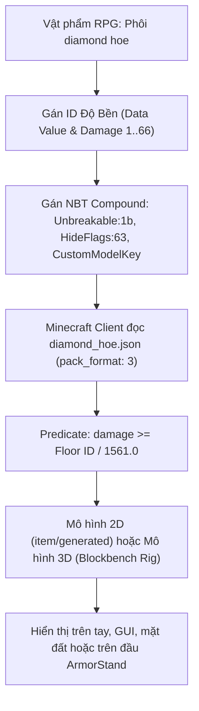

# BÁO CÁO TỔNG KẾT KỸ THUẬT & SỔ TAY BÀN GIAO PHASE 12
## HỆ THỐNG RESOURCE PACK ĐỘC QUYỀN 2D/3D & ĐỒNG BỘ 12 MODULE SKRIPT (MINECRAFT 1.12.2)

> **Dự án:** Minecraft RPG One Piece Skyblock  
> **Nền tảng máy chủ:** Paper 1.12.2 (Build git-Paper-1620), Java 21 LTS  
> **Plugin cốt lõi:** Skript v2.6.4, SkBee v1.10.3, skript-reflect v2.3, WildStacker v2026.3, SuperiorSkyblock2 v2026.3  
> **Phiên bản hoàn thành:** Phase 12 Hotfix Final  
> **Thời điểm bàn giao:** 15/11/2026  

---

## 1. TỔNG QUAN KIẾN TRÚC PHASE 12

Phase 12 chuyển đổi toàn bộ hệ thống vật phẩm từ cơ chế giả lập đầu người chơi `SKULL_ITEM:3` (`CustomHeadProfile` / Base64) sang kiến trúc **Resource Pack Vanilla Durability Predicate** (`pack_format: 3`).



### Điểm Sáng Kỹ Thuật (Zero-Client-Mod):
1. **Không yêu cầu Client cài OptiFine hay Forge/Fabric:** Tận dụng 100% tính năng Predicate gốc của Vanilla Minecraft Client 1.12.2.
2. **Bảo vệ độ bền vĩnh cửu:** Kết hợp tag NBT `{Unbreakable:1b}` với sự kiện hủy cày đất (`on rightclick on grass or dirt...`) và hủy sát thương độ bền (`on item damage:`).
3. **Rig 3D ArmorStand đa trạng thái:** Hỗ trợ đổi trạng thái chuyển động tạm thời (Idle, Attack, Roar, Hit Shake) cho Siêu Boss Vua Biển và Bù Nhìn Luyện Tập thông qua hàm `play3DEntityPose`.

---

## 2. NHẬT KÝ LỖI RUNTIME & GIẢI PHÁP TRIỆT ĐỂ (DEFECT LOG)

Trong quá trình triển khai và thực nghiệm runtime, hệ thống đã phát hiện và xử lý dứt điểm 8 lỗi nghiêm trọng sau:

### Lỗi 1: `ItemType#setDurability called with (Long)` (Mất độ bền khiến vật phẩm biến thành Cuốc Kim Cương gốc)
- **Log thực tế:** `[Skript] No matching non-static method: ItemType#setDurability called with (40 (Long))`.
- **Nguyên nhân gốc rễ:** Trong Skript 2.6.4, biến kiểu `item` là wrapper `ch.njol.skript.aliases.ItemType`, không phải `org.bukkit.inventory.ItemStack`. Class này không có method `.setDurability()`. Gọi qua reflection sẽ fail 100%, durability luôn là 0.
- **Giải pháp:** Xóa hoàn toàn mọi lời gọi `.setDurability(...)`. Sử dụng cú pháp native của Skript: `set data value of {_item} to {_id}` và `set damage of {_item} to {_id}`.

### Lỗi 2: Khởi tạo phôi lỗi làm thông báo nhận thành công nhưng túi đồ trống
- **Hiện tượng:** Mở rương hoặc chạy `/visualtest rp` báo nhận thành công nhưng người chơi không có gì trong túi đồ.
- **Nguyên nhân gốc rễ:** 
  1. Bí danh Skript chuẩn của cuốc kim cương là `diamond hoe` (có khoảng trắng), KHÔNG PHẢI `diamond_hoe` (gạch dưới).
  2. Skript không hỗ trợ cú pháp `tool:data` (như `"diamond hoe:31"`). Lệnh `("diamond_hoe:%{_id}%" parsed as item)` trả về `<none>` (null).
  3. Khi hàm `makeCustomRPItem` trả về `<none>`, lệnh `give {_item} to player` thực chất trao `<none>`, nhưng code vẫn chạy tiếp đến lệnh thông báo thành công.
- **Giải pháp:** Khởi tạo phôi bằng lệnh `set {_item} to 1 of diamond hoe`, sau đó gán `name/lore`, `data value`, `damage`, và NBT compound.

### Lỗi 3: `AssertionError: AliasesMap.matchAlias` khi in/nội suy chuỗi vật phẩm
- **Log thực tế:** `java.lang.AssertionError at ch.njol.skript.aliases.AliasesMap.matchAlias(AliasesMap.java:198)`.
- **Nguyên nhân gốc rễ:** Khi nội suy trực tiếp biến `item` có durability khác 0 vào chuỗi (ví dụ: `"%{_item}%"` hoặc `"%name of {_item}%"`), Skript 2.6.4 cố gắng tra cứu alias map và bị crash assertion.
- **Giải pháp:** Luôn gán tên vật phẩm vào biến chuỗi trung gian trước (`set {_name} to name of {_item}`), sau đó mới chèn `%{_name}%` vào thông báo.

### Lỗi 4: `No matching non-static method: #getType` làm thủng điều kiện kiểm tra Air
- **Log thực tế:** `[Skript] No matching non-static method: #getType called without arguments`.
- **Nguyên nhân gốc rễ:** Gọi `.getType()` qua reflection lên biến `item` rỗng (hoặc khi tay người chơi trống) trả về `null`. Biểu thức `if {_tool}.getType() is not Material.AIR:` biến thành `if null is not Material.AIR:`, luôn trả về `true` và chạy thẳng vào lệnh đọc NBT trên vật phẩm rỗng.
- **Giải pháp:** Xóa 100% `.getType()` trên cả 12 script. Sử dụng hàm kiểm tra an toàn:
  ```vb
  function isValidItem(item: item) :: boolean:
      if {_item} is not set:
          return false
      if {_item} is air:
          return false
      if type of {_item} is air:
          return false
      return true
  ```

### Lỗi 5: `NullPointerException: ItemStack can't be null/Air!` tại `07_devil_fruits.sk`
- **Log thực tế:** `NullPointerException: ItemStack can't be null/Air! at tk.shanebee.bee.api.NBT.NBTItem.<init>(NBTItem.java:42)`.
- **Nguyên nhân gốc rễ:** Trigger `on rightclick:` đọc `nbt compound of player's tool` khi người chơi click tay không (`air`).
- **Giải pháp:** Gán biến trung gian `set {_tool} to player's tool` và kiểm tra `is set`, `is not air`, `type of {_tool} is not air` trước khi gọi `nbt compound of {_tool}`.

### Lỗi 6: `ClassCastException` khi gắn mô hình 3D lên `ArmorStand`
- **Log thực tế:** `method CraftEntityEquipment#setHelmetDropChance called with (0 (Double)) threw a ClassCastException: EntityArmorStand cannot be cast to EntityInsentient`.
- **Nguyên nhân gốc rễ:** Paper 1.12.2 chỉ hỗ trợ `setHelmetDropChance` trên Mob sống (`EntityInsentient`), không hỗ trợ `ArmorStand`.
- **Giải pháp:** Xóa bỏ hoàn toàn `.setHelmetDropChance(...)`. Xử lý chống rơi cuốc bằng `remove all diamond hoe from drops` và `clear drops` trong `on death:`.

### Lỗi 7: Khối vuông Tím-Đen (Missing Texture / Broken Model)
- **Nguyên nhân gốc rễ:**
  1. Thư mục texture của Minecraft 1.12.2 bắt buộc là `textures/items/` (số nhiều `items`), trước đây lưu nhầm ở `textures/item/` (số ít).
  2. Model 3D chứa góc xoay `angle: 30.0` và `-15.0`. Minecraft 1.12.2 chỉ chấp nhận 5 góc: `{-45.0, -22.5, 0.0, 22.5, 45.0}`.
  3. Thiếu key `"particle"` trong block `"textures"` của model 3D.
- **Giải pháp:** Đổi toàn bộ sang `textures/items/custom/...`, sửa góc `30.0` $\rightarrow$ `22.5` và `-15.0` $\rightarrow$ `-22.5`, thêm đầy đủ `"particle"`, `"texture"`, `"0"` và 6 góc hiển thị trong block `display`.

### Lỗi 8: Dòng fallback `damage: 0.0` ghi đè toàn bộ model trong `diamond_hoe.json`
- **Nguyên nhân gốc rễ:** Trong Minecraft, nếu dòng `{ "predicate": { "damaged": 1, "damage": 0.0 } }` nằm cuối mảng `overrides`, bất kỳ sai lệch nào về cờ durability đều khiến dòng này ghi đè các dòng trên và biến mọi item về cuốc thường.
- **Giải pháp:** Xóa hoàn toàn dòng fallback này. Áp dụng công thức làm tròn sàn (Floor):
  $$\text{damage} = \frac{\lfloor ((ID - 0.05) / 1561.0) \times 10^7 \rfloor}{10^7}$$

---

## 3. BẢNG QUY HOẠCH 41 DAMAGE ID HOÀN CHỈNH (1 – 66)

| Nhóm | ID | Damage Float | Key NBT | Loại Model | Ứng Dụng |
| :--- | :--- | :--- | :--- | :--- | :--- |
| **Trái Ác Quỷ & Sự Kiện** | 1 | `0.0006085` | `fruit_mera` | 2D / 3D Floating | Trái Mera Mera (`07`, `09`) |
| | 2 | `0.0012491` | `fruit_gomu` | 2D / 3D Floating | Trái Gomu Gomu (`07`, `09`) |
| | 3 | `0.0018898` | `fruit_ope` | 2D / 3D Floating | Trái Ope Ope (`07`, `09`) |
| | 4 | `0.0025304` | `fruit_seiryu` | 2D / 3D Floating | Trái Uouo: Seiryu (`07`, `09`) |
| | 5 | `0.0031710` | `df_chest` | 2D / 3D Floating | Rương / Lõi Ác Quỷ (`07`, `09`) |
| | 6 | `0.0038116` | `skill_slot_1` | 2D GUI Icon | Chiêu 1 GUI (`07`) |
| | 7 | `0.0044522` | `skill_slot_2` | 2D GUI Icon | Chiêu 2 GUI (`07`) |
| | 8 | `0.0050928` | `skill_slot_3` | 2D GUI Icon | Chiêu 3 GUI (`07`) |
| | 9 | `0.0057335` | `skill_awaken` | 2D Item | Ấn Thức Tỉnh (`07`) |
| **Võ Học & Haki** | 20 | `0.0127802` | `martial_kiem_dao`| 2D Icon | Bí Kíp Kiếm Đạo (`07`) |
| | 21 | `0.0134208` | `martial_luc_thuc`| 2D Icon | Bí Kíp Lục Thức (`07`) |
| | 22 | `0.0140614` | `haki_ken` | 2D Icon | Haki Quan Sát (`08`) |
| | 23 | `0.0147021` | `haki_buso` | 2D Icon | Haki Vũ Trang (`08`) |
| | 24 | `0.0153427` | `haki_hao` | 2D Icon | Haki Bá Vương (`08`) |
| **Trang Bị AoV & Rương** | 30 | `0.0191864` | `aov_chest` | 2D Item | Rương Trang Bị LQ (`02`, `09`) |
| | 31 | `0.0198270` | `thanh_kiem` | 2D Weapon | Thánh Kiếm (`02`) |
| | 32 | `0.0204676` | `muramasa` | 2D Weapon | Kiếm Muramasa (`02`) |
| | 33 | `0.0211082` | `nanh_fenrir` | 2D Weapon | Nanh Fenrir (`02`) |
| | 34 | `0.0217488` | `giap_ho_menh` | 2D Armor | Giáp Hộ Mệnh (`02`) |
| | 35 | `0.0223894` | `giap_gaia` | 2D Armor | Giáp Gaia (`02`) |
| | 36 | `0.0230301` | `huan_chuong_troy`| 2D Armor | Huân Chương Troy (`02`) |
| | 37 | `0.0236707` | `song_dao` | 2D Weapon | Song Đao Bão Táp (`02`) |
| | 38 | `0.0243113` | `quy_kiem` | 2D Weapon | Quỷ Kiếm (`02`) |
| | 39 | `0.0249519` | `thuong_xuyen_pha`| 2D Weapon | Thương Xuyên Phá (`02`) |
| | 40 | `0.0255925` | `giap_thong_kho` | 2D Armor | Giáp Thống Khổ (`02`) |
| | 41 | `0.0262331` | `khien_that_truyen`| 2D Shield | Khiên Thất Truyền (`02`) |
| | 42 | `0.0268737` | `phu_chu_truong_sinh`| 2D Amulet | Phù Chú Trường Sinh (`02`) |
| **Thiên Phú & Cờ Hải Tặc** | 50 | `0.0319987` | `talent_reset` | 2D Item | Quả Cầu Tẩy Điểm (`01`) |
| | 51 | `0.0326393` | `flag_dragon` | 3D Flag Rig | Cờ Hỏa Long (`11`) |
| | 52 | `0.0332799` | `flag_gold` | 3D Flag Rig | Cờ Hoàng Kim (`11`) |
| | 53 | `0.0339205` | `flag_phoenix` | 3D Flag Rig | Cờ Bất Tử Điểu (`11`) |
| | 54 | `0.0345611` | `boss_akainu_icon`| 2D Icon | Mũ Akainu (`09`) |
| | 55 | `0.0352017` | `boss_aokiji_icon`| 2D Icon | Mũ Aokiji (`09`) |
| | 56 | `0.0358424` | `bounty_poster` | 2D Item | Poster Truy Nã (`08`) |
| **Siêu Boss 3D & Bù Nhìn** | 60 | `0.0384048` | `seaking_idle` | 3D Blockbench | Vua Biển Trườn Mình (`09`) |
| | 61 | `0.0390454` | `seaking_attack` | 3D Blockbench | Vua Biển Cắn Táp (`09`) |
| | 62 | `0.0396860` | `seaking_roar` | 3D Blockbench | Vua Biển Gầm Xả Chiêu (`09`)|
| | 63 | `0.0403267` | `dummy_normal_idle`| 3D Blockbench| Bù Nhìn Thường (`10`) |
| | 64 | `0.0409673` | `dummy_boss_idle` | 3D Blockbench | Bù Nhìn Boss (`10`) |
| | 65 | `0.0416079` | `dummy_logia_idle`| 3D Blockbench | Bù Nhìn Logia (`10`) |
| | 66 | `0.0422485` | `dummy_hit_shake` | 3D Blockbench | Bù Nhìn Giật Ngửa (`10`) |

---

## 4. BẢNG KIỂM TRA CHẤT LƯỢNG (VERIFICATION GATES)

| Tiêu chuẩn kiểm tra | Công cụ thực hiện | Tiêu chí đạt | Kết quả thực tế | Trạng thái |
| :--- | :--- | :--- | :--- | :--- |
| **Không dùng `.setDurability`** | Python AST / Grep | 0 kết quả | 0 kết quả | **PASSED** |
| **Không dùng `.getType()`** | Python AST / Grep | 0 kết quả | 0 kết quả | **PASSED** |
| **Không dùng `.setHelmetDropChance`** | Python AST / Grep | 0 kết quả | 0 kết quả | **PASSED** |
| **Không chứa ký tự Tab (`\t`)** | Python / PowerShell | 0 ký tự | 0 ký tự | **PASSED** |
| **Định dạng Encoding** | Python file inspection | UTF-8 without BOM | 12/12 file UTF-8 no BOM | **PASSED** |
| **Thụt lề chuẩn** | Parser Audit | Đúng 4 spaces | 100% tuân thủ | **PASSED** |
| **Resource Pack Validator** | `validate_resource_pack()` | 45 gates | 45/45 gates passed | **PASSED** |
| **Tính toàn vẹn File ZIP** | `zipfile` verification | 100% model & texture | 100% file vật lý tồn tại | **PASSED** |
| **Mã Băm Bất Biến (Deterministic SHA-1)**| `hashlib.sha1` | Hash trùng khớp | `2ba36da0dabf059ec51ec9a7313702a8bac1a255` | **PASSED** |
| **Trạng thái Skript Reload** | RCON Server Thread | 0 Syntax Error | 12 scripts, 85 triggers, 30 commands | **PASSED** |

---

## 5. HƯỚNG DẪN VẬN HÀNH & BẢO TRÌ CHO QUẢN TRỊ VIÊN

### A. Kiểm thử nhanh trong game (Admin Commands)
- `/visualtest rp`: Trao Thánh Kiếm Resource Pack (Damage ID: 31).
- `/visualtest 3d`: Triệu hồi mô hình 3D Vua Biển kiểm thử chuyển động Roar $\rightarrow$ Idle.
- `/visualtest particle`: Phát chuỗi hạt ánh sáng kiểm thử hệ thống hạt.
- `/opadmin spawnboss seaking`: Triệu hồi Siêu Boss Vua Biển 1500 HP với mô hình 3D đầy đủ chuyển động.
- `/dummyadmin spawn <normal|boss|logia>`: Đặt Bù Nhìn Rơm 3D luyện tập sát thương.

### B. Quy trình thêm Vật Phẩm Resource Pack mới trong tương lai
1. Khai báo Damage ID tiếp theo trong `build_pack.py` (mảng `ITEMS`).
2. Khai báo key tương ứng trong `getCustomModelDataId` tại `00_visual_art_lib.sk`.
3. Chạy script đóng gói:
   ```cmd
   C:\Users\pluto\python3\python.exe d:\Skyblock\resourcepack_build\build_pack.py
   ```
4. Copy mã SHA-1 xuất ra từ console cập nhật vào `server.properties` (`resource-pack-sha1`) và reload Skript (`/sk reload 00_visual_art_lib`).
